# Unified Feature Document: Tserver local copy of PG catalog (DocDB copy)

- Status: Draft, v2 (October 2026). v1 is `local_catalog_docdb_design_old_v1.md`.
- Author(s): @sanketh
- Tracking Issue: < Link to GitHub/Jira >
- PRD: < Link to Product Requirements Document >
- Prototype: https://github.com/iSignal/yugabyte-db/tree/local_catalog_tablet_v2. A full CI run with the feature on by default left fewer than 50 failing tests, most of them tests whose assertions count master round trips (not re-run on the latest code).

What changed from v1: the tserver no longer pulls master's WAL, master pushes it; the copy's freshness is tracked with one time, the copy's safe time, instead of comparing catalog versions held in the copy; the cases where a backend waits for the copy are enumerated; master load is measured.

## 1. Decision Framework (RAPID)

| Role      | Responsibility                                                                            | Assigned To   |
| --------- | ----------------------------------------------------------------------------------------- | ------------- |
| Recommend | Lead author(s) who propose the design                                                     | @sanketh      |
| Agree     | Stakeholders who must align on technical trade-offs. Includes PMs for the functional part | < @username > |
| Perform   | Engineers who will execute the code and tests                                             | < @username > |
| Input     | Subject matter experts consulted for specialized knowledge                                | < @username > |
| Decide    | Responsible Manager project managing this and ensuring stakeholder convergence            | < @username > |

## 2. Context Summary

### 2.1 Current State

#### How PG reads its catalog

PostgreSQL issues three broad kinds of catalog reads. All three normally run under the backend's CatalogSnapshot, a per-backend snapshot used only for catalog access.

| Kind | What                     | Example                                                       |
| ---- | ------------------------ | ------------------------------------------------------------- |
| 1    | catcache / relcache miss | DML / planning                                                |
| 2    | internal catalog scan    | planner and DML paths scanning a catalog table directly       |
| 3    | user catalog read        | `\dt`, `\d`, `information_schema`, `SELECT ... FROM pg_class` |

Exceptions that do not use the CatalogSnapshot: the walsender (historical reads for logical decoding) and ysql_dump reading the catalog at an explicit historical time.

Kind 1 is the common case. Most misses fill the catcache once per backend and never repeat, so what matters is the cost of the first few statements of every backend, and of the first statement after a DDL invalidated the caches.

#### How PG invalidates its catalog caches

<!-- fig: pg_inval -->
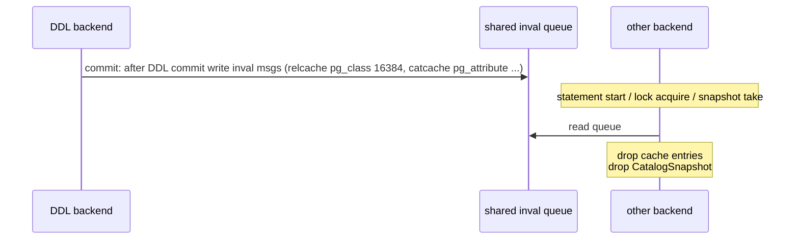

- A DDL writes invalidation messages to a shared queue at commit.
- Other backends read the queue at key points: statement start, lock acquisition, taking a snapshot.
- Reading a message drops the named cache entries and the CatalogSnapshot. The next catalog read takes a fresh CatalogSnapshot.

#### YB today, with object locking on (the 2026.2 default)

<!-- fig: yb_today -->
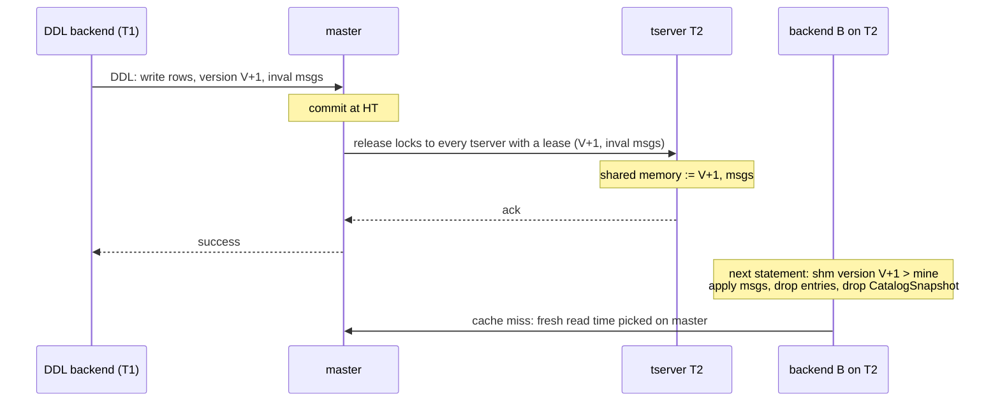

1. Every DDL increments the per-database catalog version (exception: DDL on temporary relations). The increment takes an exclusive object lock on the catalog version table, and that lock is global, so its release goes to every tserver holding a YSQL lease. The new version and the invalidation messages ride that release RPC. The DDL's client is told success only after every tserver has acknowledged it.
2. A backend reads the catalog version from master at startup. After that it watches the tserver's shared memory. When the shared version moves, the backend fetches the messages from the tserver, drops the named cache entries and drops its CatalogSnapshot.
3. A fresh CatalogSnapshot picks its read time on master. Every cache miss under it is therefore a master round trip.
4. Kind 3 reads use the CatalogSnapshot too, not the transaction snapshot. Section 6 proposes moving some of them to the transaction's read time; this design works either way.

#### Existing mitigations for a far-away catalog, and why they are not enough


| #   | Problem                                                         | Example                                                                                                                                           |
| --- | --------------------------------------------------------------- | ------------------------------------------------------------------------------------------------------------------------------------------------- |
| 1   | Initial queries on a backend are slow until the cache is warm   | `SELECT DISTINCT key, count(*) FROM part_par GROUP BY key` takes 9.3 s on a fresh backend in a far-away region, 1 ms once warm; a cold `\dt` 23 s |
| 2   | Internal catalog scans are always slow (less common)            | Fixup of pg_statistic_ext, pg_opclass (D55415)                                                                                                    |
| 3   | Thundering herd of lookups per backend after a DDL invalidation | Load proportional to the number of backends                                                                                                       |

- For problem 1: preload catalog tables into the relcache/catcache on every backend (`ysql_catalog_preload_additional_tables`, the relcache init file), plus a tserver response cache so that backends after the first one get the same rows without a master round trip. On top of that sit point fixes: a custom cache for pg_inherits, optimized relcache builds, a response cache for the authentication prefetch.
- For problem 2: replace the scan with cache lookups or preloaded data, case by case. Each internal catalog scan that turns out to be slow needs its own conversion into a cache miss.
- For problem 3: no solution exists today.

This has become too complex to keep tuning. The preload list is a per-deployment setting that trades connection time and memory per backend for first-statement latency, and gets it wrong in both directions: a workload that touches a catalog not on the list is slow on every new backend; one that does not touch the preloaded catalogs pays for them on every connection. The response cache and the init file add a second and third copy of the same rows, each with its own invalidation rule. The code that decides which path a catalog read takes has grown into a set of special cases (prefetch, preload, response cache, init file, legacy session, the per-catalog custom caches), and the kind 2 scans still have to be found and converted one by one. None of it helps kind 3 reads, which are never cached.

### 2.2 The Problem

A single query fans out into many serial catcache misses. Each miss is one master round trip, so in a multi-region cluster one first-touch query can add hundreds of milliseconds:

```
SET yb_debug_log_catcache_events=1;
SELECT distinct key, count(*) FROM part_par GROUP BY key;

LOG:  catalog cache miss on cache id 54: pg_class      part_par
LOG:  catalog cache miss on cache id 54: pg_class      part_par (schema 2200)
LOG:  catalog cache miss on cache id 2:  pg_am         2
LOG:  catalog cache miss on cache id 45: pg_proc       2803
LOG:  catalog cache miss on cache id 0:  pg_aggregate  pg_catalog.count
LOG:  catalog cache miss on cache id 80: pg_type       23
```

1. Latency on cold connections (especially multi-region).
2. Latency after DDL, when caches are invalidated and refilled from master (especially multi-region).
3. Load on the master leader, proportional to the number of backends.
4. Queries on the catalog itself, such as `\dt` or `information_schema`, can be extremely slow (especially multi-region).

Connection pools help, but:

1. The first few queries on every new backend are still very slow.
2. Some users do not run a good connection pool, or the pool opens many connections in an error state.

Measured on a three-region simulated cluster (section 10.2): in a region 30 ms one way from master, the query above takes 9.3 s on a fresh backend and a cold `\dt` 23 s; on a warm backend they take 1 ms and 0.3 s.

## 3. Functional Specification (The "What")

### 3.1 User Stories

1. Users should be able to use yugabyte in multi region clusters for regular workloads without needing to configure preloading
2. Users should not have to scale up master resources in proportion to number of tservers.
3. Direct catalog reads like ORM issued pg_type queries or DBeaver information schema queries should complete fast even in multi region clusters (if the user is willing to tradeoff strict linearizability guarantees).

### 3.2 Functional Requirements

1. All internal system-catalog reads (cache miss reads and internal catalog scans) are served from a tserver-local copy of the catalog instead of master.
2. User catalog reads (`\dt`, `information_schema`) are served from the local copy for standalone statements that read only catalog tables; the remaining cases are answered by master (section 6). A setting serves every user catalog read from the copy.
3. Catalog read related CPU usage on master from 1000 tservers stays below 10 cores even under continuous DDL.
4. A backend never reads a catalog state older than one it has already been told about.
5. Consistency of catalog reads is maintained (every read under one postgres CatalogSnapshot sees one consistent state).
6. User catalog reads of standalone catalog-only statements are served from the local copy; an optional setting serves every user catalog read from the copy for deployments that accept the skew described in section 6.

### 3.3 CLI Specification

A gflag enables the behavior (`enable_local_tserver_catalog` in the prototype), on masters and tservers. No user-facing CLI beyond that.

### 3.4 API Specification

Internal only: master pushes WAL pages to tservers (a new master-to-tserver RPC), tservers report the position they have applied in their heartbeat and can ask master for a push up to a time (a new tserver-to-master RPC). The lock-release RPC gains fields for the pages it carries. No user-facing API.

### 3.5 Terraform Specification

< Information about deployment via Ansible, Helm, TF, GitHub Actions, etc. >

### 3.6 Scope & Boundaries

- Master remains the only writer of the catalog. The copy is read-only.
- Scope assumes the 2026.2 defaults: object locking on, concurrent (transactional) DDL on, per-database catalog versions, invalidation messages on. Appendix B covers releases without object locking.
- A DDL, and every later statement in the same transaction block, reads master: its uncommitted rows exist only there.
- While the copy is on, three writers of catalog rows outside DDL are disabled: login profiles, large objects, and direct catalog updates under `yb_non_ddl_txn_for_sys_tables_allowed` outside upgrade and initdb (section 7).
- This feature does not attempt to decouple PG catalog from the sys catalog tablet / master.

### 3.7 User Experience (UI)

No user-facing UI. See section 11 for troubleshooting UIs.

## 4. Deployment Models

No orchestration changes: the copy is created and maintained by each tserver autonomously once the gflag is on. The flag must be set on both masters and tservers.

### 4.1 YugabyteDB Anywhere (YBA)

Gflag rollout only. When feature is stable/EA, YBA can automatically enable this feature for multi-region clusters.

### 4.2 YugabyteDB Managed (YBM)

Gflag rollout only. When feature is stable/EA, YBA can automatically enable this feature for multi-region clusters.

### 4.3 YugabyteD

Gflag rollout only.

### 4.4 BYOC

Gflag rollout only. When feature is stable/EA, YBA can automatically enable this feature for multi-region clusters.

## 5. Design Specification (The "How")

### 5.1 The idea

Every tserver holds a copy of master's system catalog tablet: a single-peer DocDB tablet with the same tables, schemas and row keys. Master keeps every copy current by pushing its system catalog WAL to tservers. A fresh CatalogSnapshot, which today picks its read time on master and then sends every cache miss there, instead takes its read time from the copy and sends every read to it. Nothing else about the PG backend changes: it still learns new catalog versions and invalidation messages from the tserver's shared memory, still drops its caches and its CatalogSnapshot on a message, and still writes every catalog change through master.

<!-- fig: idea -->
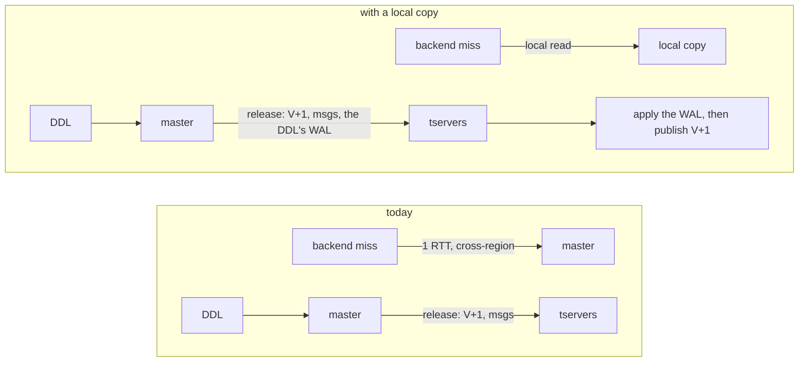

Goal: a catalog cache miss costs a local read instead of a round trip to master, for every kind of catalog read, with no preloading and no per-catalog special cases.

Correctness contract:

1. The object-locking contract is kept: a statement that acquires a lock on a relation sees the latest committed state of that relation. A DDL on the relation holds a conflicting lock until its release has landed on every tserver, each tserver releases it only after publishing the new version with the copy holding the DDL's rows, and acquiring the lock processes the invalidation messages.
2. Corollary: a DDL that locks no object it affects (GRANT, REVOKE, role changes) takes effect on every tserver within the release fan-out, because the same release reaches every lease holder and its client hears success only after all of them acknowledged.
3. A backend never reads a catalog state older than one it has already been told about. "Told about" covers the catalog version published to it, its own committed catalog writes, and anything it already read from master.
4. Every read under one CatalogSnapshot sees one consistent state.
5. By the time a DDL returns to the user, all lease-holding copies are guaranteed to see the effects in their local copy.

### 5.2 Why this is acceptable


With object locking on, YB already has a window in which different backends see different catalog states. A DDL commits on master at one instant; each tserver learns of it when the lock release reaches that tserver, and each backend applies the invalidation messages at its next statement start or lock acquisition. Between the commit and that moment an existing backend keeps using its cached entries. That is safe because of locks, as in PostgreSQL: a statement that depends on an object holds a lock on it, a DDL on that object holds a conflicting lock until its release has landed on every tserver, and acquiring a lock processes pending invalidation messages. A statement that holds no lock on what it reads, for example GRANT and REVOKE change permissions without taking an exclusive lock on the objects they affect, and user catalog reads take no object lock at all, can see the old state for the length of the fan-out. That is accepted today.

The copy does not widen that window. A tserver publishes the DDL's new version only after its copy holds the DDL's rows, and a backend that learns the version takes its next CatalogSnapshot at a time that includes them. **The difference the copy makes is that cache misses of a backend that has not yet been told the version read the copy, which may be at a state before the DDL, where today they would read master and see the DDL**. Today that is already inconsistent: the same backend's cached entries are from before the DDL, and only the invalidation messages, which come from the release, move it forward. With the copy, a backend's cache misses and its cached entries describe the same state, which is PostgreSQL's own model.

**The other visible change is for backends that have nothing cached about the objects a DDL modified: new backends, and existing backends that never touched those objects**. Today their cache misses read master and see the DDL as soon as it commits, before the release has reached their tserver. With the copy they see it when the release lands, like every other backend on that tserver (a new backend also takes its starting catalog version from the copy, in the same snapshot as its first rows, so it is never ahead of its copy). That early visibility was never a guarantee a user could rely on: on the same tserver, a backend with the objects cached keeps showing the old state until the release arrives, so an application could never tell from one backend what another would see. 

**Role DDL is the case where that early visibility is used: today a password change or `ALTER ROLE ... NOLOGIN` takes effect for new logins as soon as it commits, because authentication reads master**. With the copy, authentication reads the copy, and the change takes effect on a tserver when the DDL's release lands there. **The DDL's client is told success only after that has happened on every lease holder, so a login attempted after the client sees the DDL succeed uses the new password everywhere**. For the user the effect is the same: the DDL takes longer to return, and what it returned is in force.

### 5.3 Architecture

<!-- fig: arch -->
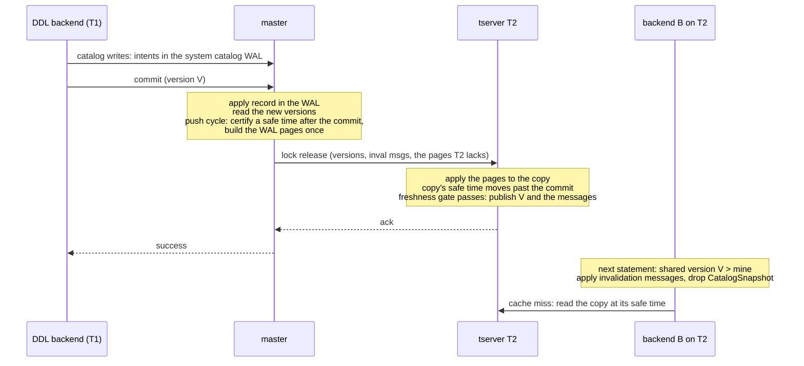

Four pieces:

- The copy: one single-peer DocDB tablet per tserver, a full copy of master's system catalog tablet (5.4).
- Master push: master keeps a cache of its system catalog WAL in page form, knows how far each tserver's copy has applied, and pushes each tserver the pages it lacks. The tserver's applier applies them and publishes the copy's safe time (5.5).
- The freshness gate: a tserver publishes a DDL's new catalog version to its backends only after the copy's safe time has passed the DDL's commit (5.6).
- The read redirect: the tserver routes catalog reads to the copy and assigns their read time (5.7).

Terms used throughout:

| Term                 | Meaning                                                                                                                                                                                  |
| -------------------- | ---------------------------------------------------------------------------------------------------------------------------------------------------------------------------------------- |
| catalog version      | Per-database counter incremented inside every DDL transaction that changes the database's catalog (temporary relations excepted). Version order equals commit order within a database.   |
| page                 | The change records of a contiguous range of master's system catalog WAL, built once on master and sent unchanged to every tserver that lacks that range.                                 |
| safe time            | A hybrid time master certifies and attaches to a page: every catalog transaction that committed at or before it is applied on master and its records are in that page or an earlier one. |
| the copy's safe time | The safe time of the last page the copy has applied, every earlier page included: a value master certified, which the copy only records. The copy is complete for every writer up to it. Moves only forward. Not the DocDB safe time of the copy's own tablet, which its single-voter Raft group computes from the local clock and which plays no part in the design beyond letting the tablet execute a read at a time below the certified one. |
| lease holder         | A tserver with a live YSQL lease. Lock releases go to every lease holder, and so does every push.                                                                                        |

### 5.4 The copy: one single-peer DocDB tablet per tserver

Each tserver holds one extra DocDB tablet: a full copy of master's system catalog tablet with the same table ids, schemas and row keys, so a WAL record produced on master applies to the copy unchanged. The tablet has exactly one peer, this tserver: it replicates to nobody.

Storage has the shape of any tablet, a regular store plus an intents store, and **the copy uses them the way an xCluster target tablet does (5.5). No transaction ever runs locally, so a read of the copy sees only rows of transactions that master committed and applied**.

**The copy is invisible to master: it is not in the tserver's tablet map, so it is never reported, and splitting, load balancing, snapshots, xCluster and admin compactions cannot address it**. Its tablet id is a reserved constant. Automatic RocksDB compactions run, with history retention pinned to master's system catalog window (4 h by default), so the copy can answer the same range of historical read times master can.

Bootstrap is a remote bootstrap from the master leader's system catalog tablet; after the transfer the tablet's metadata is fixed up: the reserved tablet id, and a Raft configuration with this tserver as the only voter. The copy serves only after master has pushed it a first page carrying a safe time, so that the copy's safe time is a value master certified rather than the transfer time (and only once the lease condition of 5.10 holds). A restart reopens the copy from disk and resumes from the position recorded on disk, without contacting master for the data.

Re-seed is the same transfer replacing the existing tablet. It is used when the local copy is behind master WAL or unusable (corruption etc) (section 7). During a re-seed the copy is not serving: catalog reads go to master.

### 5.5 Keeping the copy current: master pushes the WAL

Master pushes; no tserver pulls. One component on the master leader converts its system catalog WAL into change records, certifies safe times, keeps each tserver's applied position and sends each tserver what it lacks, under fixed in-flight bounds.

**The contract.** What master ships is its system catalog WAL as change records, the same records xCluster's producer ships to a target cluster: a row record per write, tagged with its transaction when transactional; an apply record per transaction commit, carrying the commit time; a schema-change record. With the records master sends a certified safe time, with this guarantee: every catalog transaction that committed at or before that safe time has been applied on master, and every one of its records, apply record included, is in the stream at or before that point. Row records of transactions that commit later may be in the stream without their apply record. A copy that has applied the stream up to a certified point therefore holds every transaction committed at or before that safe time, and that safe time becomes the copy's safe time. This is the contract transactional xCluster relies on.

**How WAL records are applied in the copy.** A transaction's row records are staged in the copy's intents store as external intents: one blob keyed by the transaction id, invisible to reads. When the transaction's apply record arrives, the applier writes every staged row into the regular store at the commit time the apply record carries, as one batch, leaving out rows of aborted subtransactions, and deletes the blob. A DDL's catalog rows and its version-row update therefore appear together, at the instant they appeared on master. A row record with no transaction (master's own writes) goes straight into the regular store at its own time; a schema-change record is replayed into the copy's tablet metadata.

<!-- fig: applier -->
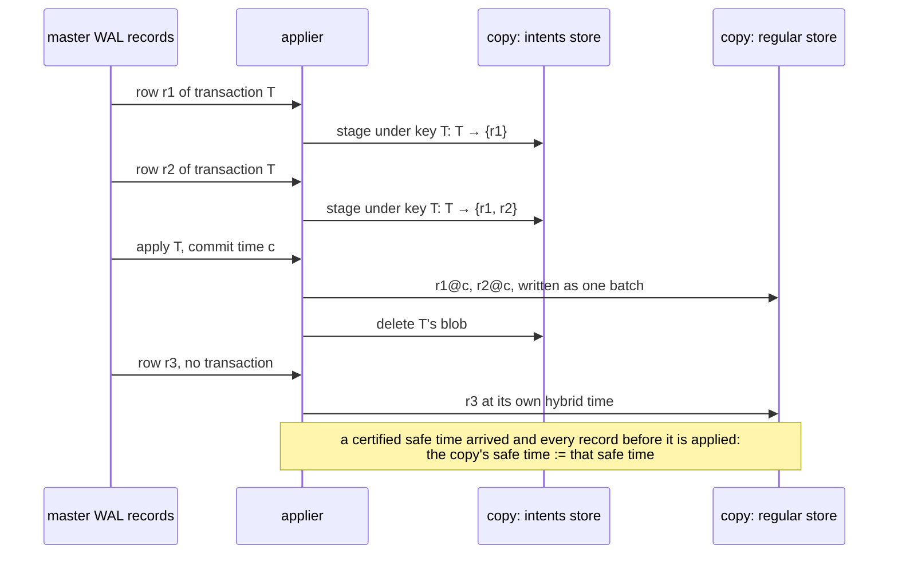

After the applier has applied every record up to a certified safe time, every transaction that committed at or before it is in the regular store, so the copy's safe time moves to it. Reads are never served above the copy's safe time (5.7), so no read ever depends on the intents store.

**Certifying a safe time: the push cycle.** One cycle certifies one safe time for the whole cluster:

```
cycle():
    S := the system catalog tablet's leader safe time
         (every write at or below S is already in the WAL, and master's clock
          has passed S, so nothing can newly commit at or below S)
    for every catalog transaction with intents here whose outcome is not known yet,
    ask its coordinator, which answers with the status and its own clock reading:
        committed at or below S          -> wait until its apply record is written here
        committed above S                -> nothing to do
        aborted                          -> remove its intents
        pending, coordinator clock > S   -> nothing to do: if it commits, it commits above S
        pending, coordinator clock <= S  -> ask again (its clock passes S within a round trip)
    position := the highest majority-replicated WAL position now
    the WAL up to that position carries S
```

**When master runs a cycle.**

| Trigger | Cycle |
|---|---|
| A lock release that publishes catalog versions | at once, so that the safe time is after the DDL's commit; the DDL's records are carried in the release (5.6) |
| A floor request: a tserver asks for its copy to reach a hybrid time some caller on it waits for | at most one cycle per 50 ms for all requests together, repeated until the safe time passes the requested time. A floor never moves master's clock; a floor ahead of master's clock costs up to the clock skew bound (500 ms) |
| Timer, every 1 minute | only if the WAL moved since the last cycle; carries catalog writes made outside DDL (master's own writes) |

**Pages.** Converting WAL operations into change records is the expensive part of shipping them, and every tserver needs the same records, so master does the conversion once per WAL range and keeps the result: a page is the change records of a contiguous range of WAL operations, serialized once and sent unchanged to every tserver below that range. A page is sealed when it reaches about 1 MB, at a restore of the system catalog (the restore is a page of its own), and at the position a cycle certified; the last page of a cycle carries the cycle's safe time, so a copy that has applied the earlier pages of the cycle has not moved its safe time yet. Master keeps the most recent 64 MB of pages in a cache; a tserver that needs older ranges gets pages built from the WAL on demand.

**Who pushes what.** One component on the master leader, the pusher, owns the page cache, one position per lease holder, and one scheduler thread that sends the pushes.

<!-- fig: pusher -->
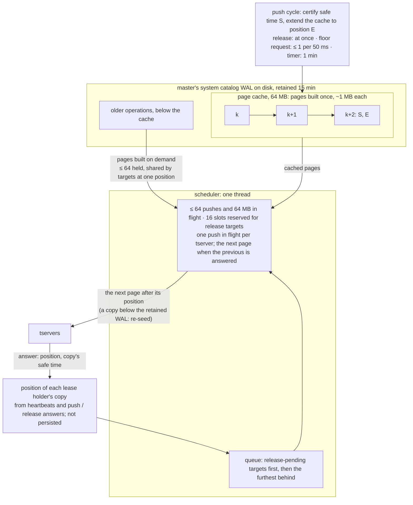

The lock release (5.6) uses the same machinery:

<!-- fig: release_flow -->
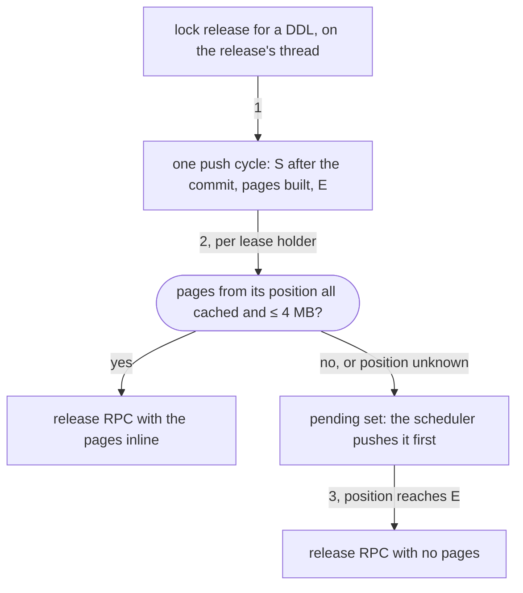

- A copy below the retained WAL gets "re-seed" instead of pages (5.4).
- A target gets its next page when its previous push is answered, so pages arrive in order. A push RPC carries one page (small consecutive ones up to about 1 MB).
- The position is the tserver's to keep: each tserver checkpoints its copy's applied position on disk (about once a second and at shutdown, never ahead of what the copy has made durable), resumes from it after a restart, and reports it in every heartbeat. A new master leader starts with no positions and learns them within one heartbeat interval.
- Cycles only add pages to the cache; the scheduler sends whatever each target lacks. A thousand tservers behind at once are served in waves under the in-flight bound, so master's CPU, memory and NIC stay at a chosen level regardless of how many are behind.
- A release (5.6) runs its own cycle on the release's thread, puts pages of at most 4 MB inline in the release RPC for targets that have them in the cache, and hands every other target to the scheduler as pending; the release RPC for such a target follows once its position has reached E.

**What a tserver can ask for.** A tserver reports its position in every heartbeat. When something on it waits for the copy to reach a time (section 7 lists the cases), it sends a floor request with its position and that time; master runs cycles until a safe time passes it and pushes the pages. A tserver that cannot catch up incrementally re-seeds (5.4).

### 5.6 The DDL path and the freshness gate

Every version-incrementing DDL ends with a lock release to every lease holder, because the increment holds the global exclusive lock on the catalog version table. Master reads the new versions after the DDL committed and sends them, with the invalidation messages and the time it read them at, in the release. What master does with the release:

1. One push cycle: certify a safe time and build the new WAL into pages in the cache. The cycle needs no knowledge of the DDL's commit time: the version read came first and saw the committed version row, so its read time is at or above the commit, and the cycle's safe time, taken afterwards, is at or above the read time. The DDL is therefore among the transactions the cycle covers, and its apply record is already in the WAL.
2. For each lease holder, the pages it lacks are those from its last acknowledged position to the cache's end. When they are all in the cache and total at most 4 MB (up to four pages), they travel inside that target's release RPC. Otherwise (the position is unknown after a master leader change, it is below the cache, or the pages exceed the cap, as for a `CREATE DATABASE` of about 12 MB) the target is pushed the pages first among the pusher's queue, and its release RPC, with no pages, is sent once master sees the target caught up.
3. Fan the release RPCs out.

The 4 MB cap exists because the release RPCs go to every lease holder at once, outside the push's in-flight bounds; anything larger goes through the bounded push instead.

The release handler on each tserver, in this order:

1. Apply the pages carried in the release, if any.
2. **Check that the copy's safe time is at or above the time master read the versions at.** In the normal case this holds by construction: the pages just applied (or the pushes that preceded this release for a target that was pending) end with the cycle's safe time, which is above the read time. It fails only when master's view of this copy's position was stale, because the copy restarted from an older checkpoint, re-seeded, or a page was lost in flight, so the inline pages did not fit and were refused. **The handler then answers "behind" with the copy's position and safe time, keeps the locks held, and master pushes from the real position and sends the release again once the copy is at the cycle's end. The handler never waits.**
3. Publish the versions and the invalidation messages to shared memory.
4. Release the local locks and acknowledge.

Step 2 is the freshness gate, and it is the only thing the copy adds to DDL version propagation. A backend that takes a lock conflicting with the DDL's lock always sees the new version first; a backend that learns the version from shared memory takes its next CatalogSnapshot at the copy's safe time, which is past the DDL's commit. The DDL's client is told success only after every target has acknowledged, including the DDL's own tserver.

This is a deliberate trade-off between DDL latency and DML latency. The alternative is to release the locks and publish the version as soon as the release arrives, and to make every catalog read on that tserver wait until the copy has caught up to the published version, the way an xCluster target stalls a read beyond its safe time. That keeps DDLs fast on a lagging copy but stalls every backend on that tserver that takes a fresh CatalogSnapshot, including backends whose statements have nothing to do with the DDL, and the stall is unpredictable from the application's point of view. The chosen rule puts the whole cost on the DDL and on DML that waits for the DDL's own locks: a lagging copy makes that DDL slower, and nothing else on the tserver notices. The one exception is a tserver whose PG is not running (5.10), where there is no backend to protect and the release is acknowledged at once.

While a copy is not serving (bootstrap, re-seed, lease lost), its release handler publishes at once, queues the pages, and raises the time the copy must reach before it may serve to the release's read time. A copy that is not serving has no backends reading it to protect, and when it starts serving it holds every version its tserver has published (5.10).

<!-- fig: gate -->
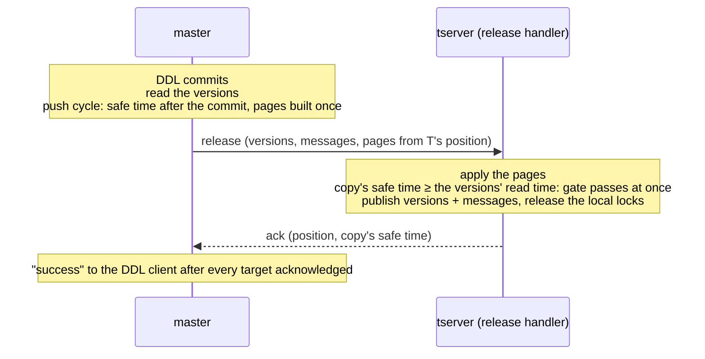

A release completes only when every lease holder has acknowledged it or lost its lease: master keeps the release, with its versions and read time, and sends it to a target that is behind once that target's pushes have brought it up. The DDL's tserver waits for the release for at most the synchronous timeout (60 s). If the release has not completed by then, the DDL returns an error to its client: the DDL may have committed, but its effect is not yet in force on every tserver, the same situation as a commit whose response was lost. Master keeps completing the release in the background, and the DDL's own session is covered by the session floor of 5.7.

Heartbeats carry catalog versions as before, but a tserver whose copy is serving ignores them: every version change that matters reaches it in a release (or the restore message of section 7). A tserver whose copy is not serving applies them at once; that is its catch-up path.

### 5.7 Read path

DDL writes are unchanged: every catalog write goes to master.

**What is served locally.** All three read kinds, when the backend is not in a DDL transaction: cache miss reads, internal catalog scans, and user catalog reads under the rule of section 6. The startup catalog reads of a new backend, the full cache refresh and parallel workers use the same path, so a fresh connection makes no master catalog round trip. The catalog version row is read in the same snapshot as the rows, so the version a backend adopts is one the copy holds.

**The read time.** PG's CatalogSnapshot holds no hybrid time; the tserver keeps the time per snapshot. The rule, evaluated by the tserver for each catalog read:

1. A fresh CatalogSnapshot gets the copy's safe time as its read time, without waiting, and every later read under that snapshot reads at the same time. The copy's safe time only moves forward, so that time stays at or below it: one state per snapshot, even while the applier advances.
2. A snapshot that already has a time above the copy's safe time (an explicit read time such as `yb_read_time`, `ysql_dump --read-time`, or the walsender's historical reads) is never clamped down, because that would return an older state under the same snapshot. The tserver asks master for a push up to that time, waits, and serves at exactly that time.
3. A read below the copy's history retention goes to master.
4. **The session floor: a session remembers one time that its next fresh CatalogSnapshot from the copy must not fall below, and the tserver waits (with a floor request) until the copy's safe time has reached it. The floor is set when a catalog read of this session was answered by master (a DDL-mode read, or a read the copy could not serve)**, to the clock reading when the answer arrived, and when this session commits a transaction that wrote catalog rows, to the commit time. It is cleared once the copy has passed it. Normally the DDL's own release has already moved the copy past the commit, so no wait happens.

<!-- fig: read_time -->
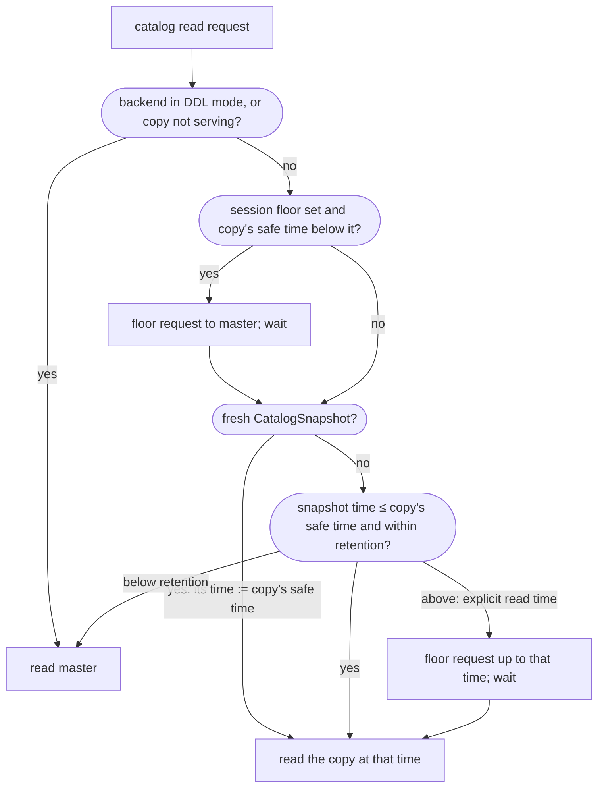

**What goes to master.**

| Case                                                                                 | Why                                                                                                                                                                                                                                                                                                                                                                                                                                                                                |
| ------------------------------------------------------------------------------------ | ---------------------------------------------------------------------------------------------------------------------------------------------------------------------------------------------------------------------------------------------------------------------------------------------------------------------------------------------------------------------------------------------------------------------------------------------------------------------------------- |
| Backend is in a DDL statement or a transaction block in which a DDL ran              | Its uncommitted catalog rows exist only on master, and its own cache misses must see them. PG drops the CatalogSnapshot at the first command counter increment after a catalog write (it applies its own invalidation messages locally, as in stock PG), and the recreated CatalogSnapshot gets its read time from master, on the DDL transaction's read point, where the backend's uncommitted rows are visible to it. These reads set the session floor. |
| Session has `yb_non_ddl_txn_for_sys_tables_allowed` set (upgrade migrations, initdb) | The session may hold uncommitted catalog rows only master has.                                                                                                                                                                                                                                                                                                                                                                                                                     |
| SERIALIZABLE transaction                                                             | A serializable transaction's reads carry no read time in YB (each read runs at the tablet's current time, with read locks instead of a snapshot), and today its catalog reads do the same, so each is answered by master at its own time; two catalog reads under one CatalogSnapshot can straddle a DDL commit on an object the statement did not lock, as they can without the copy. Planned: serve them from the copy at one time, like the other isolation levels (section 7). |
| Read time below the local history retention                                          | Would raise a snapshot-too-old error; the copy keeps master's 4 h retention.                                                                                                                                                                                                                                                                                                                                                                                                       |
| Non-MVCC snapshots (self, dirty, any) and historic snapshots                         | All are DDL-side or logical-decoding paths.                                                                                                                                                                                                                                                                                                                                                                                                                                        |
| Copy bootstrapping, re-seeding, faulted, or the YSQL lease lost                      | The copy is not in the read path (5.10). A session whose read went to master in this state stays on master until the backend exits (section 7).                                                                                                                                                                                                                                                                                                                                    |

**What the backend does with versions and messages: unchanged.** A backend watches the tserver's shared version; when it moves, the backend fetches the invalidation messages from the tserver, applies them and drops its CatalogSnapshot. The tserver fills shared memory from the release, after the gate. (Reading the messages from the copy instead of the tserver's message cache is possible, since the messages catalog is in the copy, and is not part of this design.)

### 5.8 What is no longer needed

| Today                                                                                                                                                                                              | With the copy                                                                                                                                                                                                           |
| -------------------------------------------------------------------------------------------------------------------------------------------------------------------------------------------------- | ----------------------------------------------------------------------------------------------------------------------------------------------------------------------------------------------------------------------- |
| Sys-table preloading (`ysql_catalog_preload_additional_tables`): the shared catalogs before authentication, then the database's catalogs, fetched from master in batched reads on every connection | Removed. Init follows standard PG: catcache and relcache entries load lazily, each miss a local read. The relcache init file stays, because rebuilding the relcache from it is faster than one local read per relation. |
| Tserver response cache for the preload and for authentication                                                                                                                                      | Removed; the copy answers the same reads locally.                                                                                                                                                                       |
| Mid-statement full cache refresh (a version arrives whose messages are unusable): re-runs the preload against master                                                                               | Removed. The caches are reset to empty and reload lazily from the copy.                                                                                                                                                 |
| Per-catalog custom caches and the conversion of slow internal scans into cache lookups                                                                                                             | Not needed: an internal scan is a local read.                                                                                                                                                                           |
| Catalog versions delivered by heartbeat to a healthy tserver                                                                                                                                       | Ignored while the copy serves; the release is the only path. Heartbeats still carry each tserver's applied position to master.                                                                                          |

### 5.9 Modes in which the copy is not used

- initdb: no redirect; the copy is bootstrapped only after master reports initdb complete.
- YSQL upgrade migrations: upgrade-mode sessions write catalog rows outside DDL with `yb_non_ddl_txn_for_sys_tables_allowed` set and read master; ordinary sessions are unaffected

### 5.10 Failure handling

**Lease loss, lease regain and tserver restart.** A tserver without a live YSQL lease is not a target of lock releases, so master completes DDLs without this tserver running the freshness gate. Every such DDL committed before master granted this tserver its next lease. The rule:

- On loss, the copy leaves the read path at once; lease loss also ends this tserver's PG sessions, as it does without the copy.
- On every new lease epoch, including the first lease of a freshly started process, the tserver takes a clock reading (its clock plus the maximum skew), which is at or above every DDL master could have completed without it, and asks master for a push up to it. PG is started only when the copy's safe time has reached the bound, so the first backend finds every published version in the copy. With PG not running there are no backends that could read a stale copy. The hold has no timeout: the cases that make it long (an outage longer than master's WAL retention) end in a re-seed, which the hold also waits for.
- Every release that arrives while the copy is catching up publishes its versions at once and raises that bound to its own read time, so a tserver never starts PG with a stale copy.
- Catch up from lease loss may involve RBS or WAL catchup.

The tserver therefore has three states with respect to its lease and its copy:

| State | Lease | PG | Release handling | Reads |
|---|---|---|---|---|
| no lease | none | stopped | not a target | none |
| lease held, copy catching up | held | held back | publish at once, raise the start bound, acknowledge | none |
| serving | held | running | apply, gate, publish, unlock (5.6) | the copy |

The middle state is what makes a lease holder that cannot keep up harmless to the rest of the cluster: it acknowledges every release immediately because it has no backend that could read a stale copy, and it is its own PG start, not anyone's DDL, that waits. It is not the general rule for a serving tserver, because there a release acknowledged before the copy caught up would let running backends read below a version they were told about; that is the trade-off of 5.6.

<!-- fig: lease_states -->
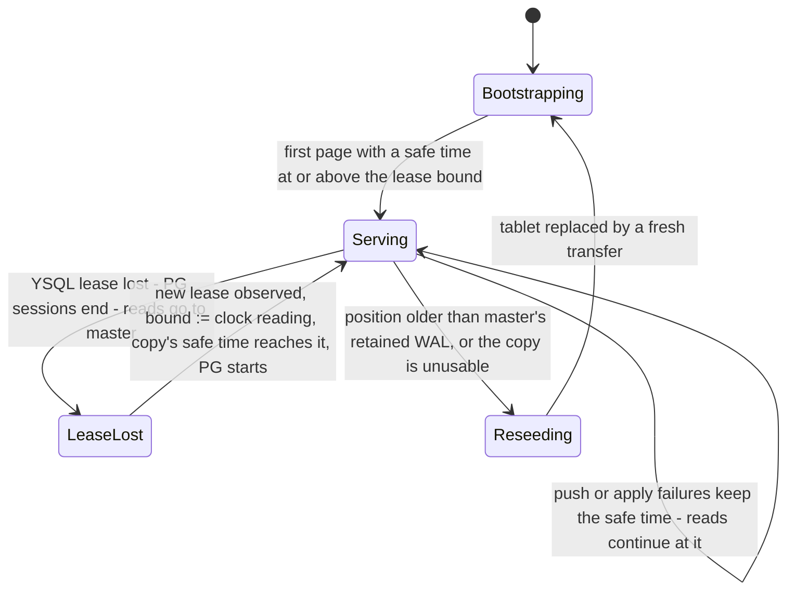

A joiner wave (many tservers regaining their leases at once, each needing minutes of WAL) does not hold DDLs back: every one of them is in the middle state above, so its release handler acknowledges without waiting; it is the copy's own start of serving that waits for those DDLs' pages. Master's in-flight bounds keep the catch-up pushes from crowding out the releases' own pages.

**Local faults.** After N consecutive apply failures, or a corruption-class error while applying or reading, the copy leaves the read path: reads go to master, the gate is skipped. The copy re-seeds and serves again once its safe time has reached every time that was published meanwhile. A backend whose catalog read went to master during that window stays on master until it exits (section 7). A copy that merely lags, because master is slow to push, stays in the read path: reads continue at the old safe time, DDLs wait at the gate.

**Master leader change.** The new leader starts with an empty page cache and no positions; positions arrive with the next heartbeats. Copies keep serving at their last safe time; a tserver that waits repeats its floor request, which reaches the new leader.

### 5.11 Security and Privacy Implications

The copy holds the same catalog data the tserver already receives today (invalidation payloads, heartbeats) and full catalog rows already reachable through any backend. Data at rest inherits the tserver's encryption configuration like any tablet. The push is master-to-tserver internal traffic under the existing server-to-server TLS.

### 5.12 Identity

No impact.

### 5.13 Encryption

The copy is a regular tablet on the tserver and inherits encryption at rest; the push rides existing intra-cluster TLS.

### 5.14 Compliance

No new third-party libraries or vendors.

### 5.15 Networking

New master-to-tserver push payloads, pages inside the existing lock-release RPC, and a small tserver-to-master floor request. No new ports. Bytes: N copies of each DDL's WAL leave master's NIC (section 10).

### 5.16 Threat Modeling

No new externally reachable surface.

### 5.17 Version Compatibility/Upgrade

#### 5.17.1 Compatibility Notes

- Rolling upgrade: old tservers have no copy and read master; the feature is per tserver and correctness never depends on a tserver having the copy.
- Major PG version upgrade: no special case (section 7).

#### 5.17.2 Backward Compatibility and Backfill

No backfill: a tserver builds its copy by remote bootstrap whenever the flag turns on.

#### 5.17.3 Rolling Upgrade Considerations

The push service is new on master; tservers take part only when the flag is on. Enable after all nodes run the new version.

#### 5.17.4 Finalize Considerations

The flag should stay off until upgrade finalize, allowing downgrade.

### 5.18 Licenses

None.

### 5.19 Third-Party References

None.

## 6. User catalog reads

This section covers executor scans of catalog tables issued by user SQL: `\dt` and the other psql meta-commands, `SELECT ... FROM pg_class`, the `information_schema` views, schema browsers and migration tools that check `pg_class` before acting. Catcache and relcache loads keep the rules of 5.7.

### 6.1 Why they need their own rule

PostgreSQL runs two snapshots in one backend: the catalog snapshot, used by catcache and relcache loads and refreshed on every invalidation, and the transaction snapshot, used by executor scans, including executor scans of catalog tables. In PostgreSQL `SELECT ... FROM pg_class` therefore sees the transaction snapshot's state, like any other table. In YugabyteDB today pggate puts every read of a catalog table on the catalog snapshot's read time, by table alone. With the copy that time is the copy's safe time, and two things can go wrong:

- Linearizability across tservers. While a DDL's release is still fanning out, a client that runs `\dt` on a tserver that has published it and then on one that has not sees the new table and then does not. The window is the release fan-out (5.2); catcache reads have the same window today.
- MVCC inside one transaction or one statement. A catalog read at the copy's safe time and a user-table read at the transaction's or statement's read time, normally later, can disagree: inside a REPEATABLE READ transaction, `SELECT ... FROM pg_class` does not show a table the same transaction created; inside one statement, `SELECT ... FROM pg_class, tenants` run just after another session committed `CREATE TABLE t2; INSERT INTO tenants VALUES (42)` can return the tenant row and not the table; and a user-defined function called from a catalog-only statement, `SELECT f(relname) FROM pg_class`, runs its own user-table queries at the statement's time while the outer scan ran at the copy's.

<!-- fig: user_catalog_skew -->
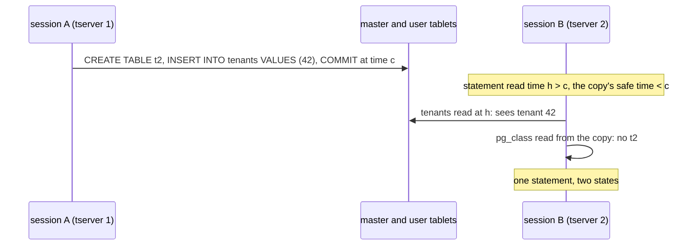

### 6.2 Proposal

User catalog reads are served from the copy by default when both conditions hold, decided once at executor start, when the planned statement's range table is final and views are expanded:

1. The statement is not inside an explicit transaction block.
2. The statement references only catalog tables and calls no user-defined function. A user-defined function is one whose oid is above the built-in range; extension functions count as user-defined, which is conservative.

This admits `\dt` and the other meta-commands, `SELECT ... FROM pg_class`, the `information_schema` views (they expand into catalog relations and call only built-in functions, which read catalogs only) and schema-browser queries of the same shape. It rejects any statement inside `BEGIN ... COMMIT`, `SELECT ... FROM pg_class, user_table` and `SELECT f(relname) FROM pg_class` for a user function `f`. A rejected statement's catalog scans keep the transaction's read time and go to master, which is PostgreSQL's semantics and today's cost; later, such a scan is served from the copy when that time is at or below the copy's safe time, the normal case under REPEATABLE READ because the time was fixed at transaction start.

With both conditions met only the linearizability window of 6.1 remains, the same one catcache reads have; Appendix A has the optional lock that closes it. A setting serves every user catalog read from the copy, today's behaviour, for a deployment that accepts the skew.

## 7. Special cases, and where a backend waits

The assumption everything rests on: every lease holder eventually receives and applies master's system catalog WAL, by pages or by a re-seed. The cases below are where that needs help, or where a backend must wait for it.

### 7.1 Remote bootstrap copies state the copy must not trust

Remote bootstrap copies master's system catalog tablet as it is at that moment. Two things in that copy are not certified the way a page is, and each needs its own fix before the copy applies its first page.

**(a) The intents of open transactions.** A page stages a transaction's rows in a form only its apply record can materialize. Remote bootstrap instead copies the ordinary row-keyed intents of every catalog transaction still open at that moment, and the copy's own transaction machinery would later ask the transaction's coordinator for its status; once master has applied and forgotten the transaction, the answer is "aborted" and the copy removes rows master committed, silently, until the next re-seed. xCluster avoids this by aborting active transactions on the source at bootstrap, which is not acceptable here: a tserver can bootstrap at any time and that would abort in-flight DDLs cluster-wide.

Fix: convert every open transaction's copied intents into exactly the staged form the applier would have written had master pushed those records, and never let the copy's transaction machinery resolve a status. The transaction's later records and its apply record then arrive by push and find all of its rows.

**(b) The uncommitted tail of the log.** The copied log segments include entries master's leader had appended but not yet replicated to a majority. Every WAL entry carries the leader's committed index as of the moment it was written, and tablet bootstrap on any peer uses it: it replays only entries at or below the highest committed index it has seen and leaves the rest in the log as pending. 

On a normal peer, Raft then settles the pending entries: the peer is a follower, and if the leader lost leadership before they committed, the new leader's log overwrites them. The copy is a single-voter Raft group: it becomes its own leader on open, every pending entry counts as committed, and it applies them all, so an operation master never committed would become part of the copy and nothing would ever correct it, until the next re-seed. Rare (a master leader change at the instant of the bootstrap) and silent.

Fix: after bootstrap, the copy drops the pending entries instead of letting its own group commit them, so its log ends at master's committed index, and that index is the position it reports to master; master's first pages start right after it. As a check, the position carries the entry's term as well as its index, and master compares it with the term of the entry at that index in its own log. A committed entry is never replaced, so the terms agree; a mismatch means the copied tablet was not what it claimed, and master answers "re-seed".

In both cases the copy serves only after master's first page with a safe time.

### 7.2 Backends that read master, then come back to the copy

Four kinds of backend read master and later come back to the copy:

| Backend                                                                              | Why it reads master                                                                                                        |
| ------------------------------------------------------------------------------------ | -------------------------------------------------------------------------------------------------------------------------- |
| In a DDL statement, or in a transaction block in which a DDL ran                     | Its uncommitted catalog rows exist only on master.                                                                         |
| After a DDL on a temporary relation, or a `DISCARD` that dropped temp objects        | Such a DDL increments no catalog version, so other sessions need nothing; the writing session must still see its own rows. |
| SERIALIZABLE transaction (today; planned: served from the copy, 5.7)                 | Its catalog reads carry no read time and are answered by master at its own time per read.                                  |
| A user catalog read inside a transaction block or mixed with user tables (section 6) | Master at the transaction's read time; later served from the copy when that time is at or below the copy's safe time.      |

How they come back, for all four: the session floor. A backend keeps one floor time. Every catalog read answered by master sets it to the tserver's clock reading when the answer arrived: the answer carries master's hybrid time, so that reading is at or above everything the read saw. A commit of a transaction that wrote catalog rows sets it to the commit time from the commit response. The floor is checked only when the backend's next fresh CatalogSnapshot takes its time: if the copy's safe time is below the floor, the tserver asks master for a push up to it and waits; reads under an existing snapshot keep their time, which is at or below the copy's safe time, and need no check. The floor is cleared once the copy has passed it. In the routine case nothing waits: the DDL's own release has moved the copy past the commit before the client hears success, and a temporary relation's exclusive lock release does the same. What does wait, one push round trip each: a DDL block that rolled back, a serializable transaction today, and a user catalog read in a transaction block.

Two cases are not master reads but belong here:

| Backend                                                                                                   | What happens                                                                                                                                                                                                                                                                                                                                       |
| --------------------------------------------------------------------------------------------------------- | -------------------------------------------------------------------------------------------------------------------------------------------------------------------------------------------------------------------------------------------------------------------------------------------------------------------------------------------------- |
| An explicit read time above the copy's safe time (`yb_read_time`, `ysql_dump --read-time`, the walsender) | Never clamped down: the tserver asks for a push up to that time and serves at it.                                                                                                                                                                                                                                                                  |
| A read while the copy was not serving (bootstrap, re-seed, local fault)                                   | The backend stays on master until it exits. Its cache and its last statement reflect master at a time the copy may not have reached when it serves again, and letting it switch back freely could show a change and then lose it. Backends that did no catalog read during the outage keep using the copy; backends started after it use the copy. |

Under object locking the session floor is a cheap mechanism: the release the DDL's own increment produces moves every copy past the commit before the client hears success, so the floor is already satisfied in every routine case.

### 7.3 Lease loss, lease regain, tserver restart

Section 5.10. Backends are ended on lease loss as today; **PG starts again only when the copy's safe time has reached the clock reading taken at the new lease or latest release locks rpc received, which is at or above every DDL master completed without this tserver**. On every new lease, including the first lease of a restarted process, the tserver sends master a floor request for that clock reading together with the copy's checkpointed position, and master runs a cycle and pushes what the copy lacks. The wait is one push round trip plus the clock skew bound (0.5 s) in the routine case, the missed WAL after an outage, or a re-seed after an outage longer than master's WAL retention. A restart therefore always costs one floor request and at least one page, even when the copy is already current, because only a certified safe time at or above the lease bound lets PG start.

### 7.4 A release that does not complete

If the DDL's backend dies after commit, its tserver sends the release in its session cleanup; if the DDL's tserver dies, master releases that lease epoch's locks when the lease expires, and that release carries the versions too.

Master retries the release until all lease holding tservers' copies acknowledge. Until then the DDL's locks stay held on that tserver, so DML on the DDL's objects there waits; everything else proceeds at the old version. The DDL's tserver waits for the release for at most the synchronous timeout (60 s) and then returns an error to the client; master keeps completing the release in the background.

That error leaves the user without a way to know when the DDL will be in force everywhere, and the usual reaction to a DDL error, running it again, does not help: `CREATE ROLE` fails with "already exists", and nothing says when the first attempt will have propagated. The copy's observability (section 11) therefore exposes each in-progress release and, per lease holder, whether it has acknowledged, so that an operator can see which tserver a DDL is waiting on and when it completed.

### 7.5 A DDL announced through user data or NOTIFY

The freshness gate delays only the acknowledgement to the DDL's client. Everything else the DDL's transaction did is visible from its commit: rows it wrote to user tables, and a `NOTIFY` it sent, are seen everywhere at once, while each tserver's copy shows the catalog change only once the release has landed there. An application that learns of a schema change through one of those channels and then uses the new object can run ahead of the catalog on its tserver:

```
session A (tserver 1)                      session B (tserver 2), LISTEN schema_changes
BEGIN;
CREATE TABLE t2 (...);
INSERT INTO deployments VALUES ('t2');
NOTIFY schema_changes, 't2';
COMMIT at time c
  user rows and the notification:
    visible from c
  the catalog change: on each tserver,
    once its release landed
                                           notification arrives (or a poll of
                                           deployments returns 't2')
                                           SELECT * FROM t2
                                             -> "relation t2 does not exist"
                                             the name lookup reads the copy at its
                                             safe time, below c; no lock on t2 is
                                             taken before the name resolves
release lands on tserver 2:
version published, copy past c
                                           SELECT * FROM t2 -> works
```

Without the copy, B's statement takes a fresh catalog snapshot on master at a time after c and finds t2, so B sees the table as soon as it is told about it. The exception is a backend that had looked t2 up before the DDL and holds a negative cache entry for the name: it gets the same error until the invalidation messages reach it, which is the same window. The copy extends that window to backends with no such entry. DML against an object whose name does resolve is safe: it blocks on the object lock, which this tserver releases only after publishing. 

We can fix this by making NOTIFY in a DDL txn wait until all local copies are caught up but for now, we plan to ignore this anomaly.

### 7.6 Incompatible features

Three writers change catalog rows outside DDL. Nothing tells other sessions, and nothing moves the copy for them until the next push. They are disabled while the copy is on; support is a follow-up.

- Login profiles: a failed login increments the role's failed-attempt counter outside DDL. With the copy, attempts spaced closer than one push read the same counter, so the lockout arrives late. Candidate: reads of the profile catalogs always go to master.
- Large objects: `lo_create`, `lowrite`, `lo_unlink` write `pg_largeobject` from the user's transaction outside DDL; another session would read them from the copy and miss an object written just before. Candidate: those catalogs always from master.
- Direct catalog updates under `yb_non_ddl_txn_for_sys_tables_allowed`, outside upgrade and initdb.

### 7.7 PITR restore of the system catalog

A restore is one Raft operation in master's system catalog WAL that carries the instruction (the snapshot and the restore time), and every master peer, leader and followers, executes it on its own files: it hides every row version of the database above the restore time with a filter on its SST files and writes the raised catalog version row directly into its RocksDB. The row changes are therefore not in the WAL, and no page can carry them; a page only marks where the restore operation sits. The copy does what a follower does. Master sends a restore message to every lease holder with the same instruction: the database, the restore time and the new version. Each copy applies the same filter to its own files (it keeps master's catalog history for this), writes the version row, and publishes the version after its safe time has passed the restore operation. Master reports the restore complete only after every lease holder has acknowledged, so a connection opened after RESTORED reads the restored catalog, as it does without the copy. A copy whose history does not reach back to the restore time re-seeds instead. Existing backends see the new version, which has no invalidation messages, and reset their caches.

### 7.8 Major version upgrade

The design is in 5.9: the copy keeps serving, and the restart rule of 7.3 is what puts the new catalog in front of the first new-binary backend. The cost is on the rolling restart: each tserver's PG start waits for the upgrade's WAL volume at that moment (initdb plus pg_upgrade of every database); a push triggered at the end of the catalog build, before the restarts, would pre-load every copy.

### 7.9 Where a backend or a client waits

| Who waits                                                                                                                              | For what                                                                                                                                                        | Routine cost                                                                                                    |
| -------------------------------------------------------------------------------------------------------------------------------------- | --------------------------------------------------------------------------------------------------------------------------------------------------------------- | --------------------------------------------------------------------------------------------------------------- |
| The DDL's client, and DML on the DDL's objects that is waiting for the DDL's lock                                                      | every lease holder's copy to apply the DDL's pages and publish (the freshness gate); on a tserver whose release is late, the locks stay held until it completes | the apply of a few KB per tserver; the slowest lease holder sets the time; after the 60 s synchronous timeout the DDL returns an error and the release completes in the background |
| The DDL's own session, next statement                                                                                                  | the copy's safe time to pass its commit                                                                                                                         | none: the release already did it; one push round trip after an asynchronous release                             |
| A session after a DDL block that rolled back, or after a SERIALIZABLE transaction, or after a user catalog read in a transaction block | the copy's safe time to pass the time of its last master read                                                                                                   | one push round trip                                                                                             |
| PG start after a restart or a new lease                                                                                                | the copy's safe time to reach the clock reading at the lease                                                                                                    | one push round trip plus the skew bound; the missed WAL or a re-seed after an outage                            |
| A connection during a PITR in-place apply                                                                                              | the copy's flush and reopen                                                                                                                                     | short                                                                                                           |

## 8. Alternatives Considered

### 8.1 Rejected Approaches

#### L1: a PG-heap copy of the catalog on every tserver

Same idea, a local copy updated with the DDL's changes pushed on the lock release, but held as PG heap tables (with the catalog's indexes) on each tserver's PG side, written by a writer connection applying heap-tuple deltas recorded by the DDL. A miss is then an in-process heap read (about 10 µs against about 200 µs for the DocDB copy). Prototype: https://phorge.dev.yugabyte.com/D53688 (about 200 test failures remaining).

Rejected because the incremental-update machinery must be built and proven by hand, where the DocDB copy reuses battle-tested paths (remote bootstrap, WAL replication, external-intent apply):

- Row identity: every local table needs a ybctid column so a delta can find the row it updates or deletes; a missed ybctid leaves an undeletable stale row.
- Capture coverage: every catalog write path must be captured (CatalogTupleInsert/Update/Delete, in-place updates, subtransaction rollback), and deltas must be tagged and routed shared vs per-database.
- DDLs that skip the version bump today must bump it once they captured rows.
- Consistency depends on PG xid snapshots over the local tables working correctly.
- More read classes stay on master (walsender, all historic reads, some recursive lookups, catalogs not shadowed).

| Dimension               | L1 PG copy                                                                                               | L2 DocDB copy (this design)                          |
| ----------------------- | -------------------------------------------------------------------------------------------------------- | ---------------------------------------------------- |
| Setup                   | One heap + indexes per catalog per database, extra ybctid column, per-database copies of shared catalogs | One tablet, same schemas as master                   |
| Bootstrap               | Manual full scan; published version must match data read                                                 | Remote bootstrap; reopened from disk                 |
| Incremental update      | Manual capture of every write path; likely needs bake time                                               | WAL pushed by master, applied as xCluster does       |
| Snapshot semantics      | PG xid snapshots over the local heap                                                                     | DocDB read time at the copy's safe time              |
| Miss cost               | ~10 µs, in process                                                                                       | ~200 µs, tserver-local RPC                           |
| Master load             | None beyond the release; release carries full old+new tuples (large for ANALYZE)                         | One push cycle per DDL plus one push RPC per tserver |
| Special cases to master | More: DDL, walsender, historic reads, startup prefetch                                                   | Fewer: DDL, lease loss / re-seed                     |
| Other                   | Memory per backend to seed relcache entries for all shadow relations                                     | Master NIC: N copies of each DDL's bytes             |

The miss-cost difference rarely matters: most misses end in the catcache and never repeat on that backend.

#### Short-term alternatives (complementary, not equivalent)

- S1 Region-local consistent copies (prototype D53843): region-pinned DocDB copies of 47 per-database + 7 shared catalogs, written by every DDL in the same transaction. The only option with no read exceptions (a DDL reads its own writes from the copy), but a miss is still a same-region RPC with intent resolution, it needs lease-aware writes to every copy, and manual setup.
- S4 Tserver response cache (prototype D54266): cache whole catalog tables per (db, version) on the tserver. No incremental path: any DDL invalidates the full set for that database and the first miss after a DDL repopulates from master; memory-bound; catalog tables are duplicated per index.

#### Tservers pull instead of master pushing (v1 of this design)

v1 had each tserver poll master for its own window of the WAL. Master then rebuilt and serialized the same records once per tserver (97% of its CPU under load) and certified a safe time once per requester, so a burst saturated master for seconds and, through its RPC pools, could take the lease service with it. Section 10.3 has the numbers; the push replaced it.

## 9. Interoperability and Compatibility

### 9.1 Data Plane

| Area             | Sub Areas                       | Is Affected | Brief description                                                                                                                                                                                                    |
| ---------------- | ------------------------------- | ----------- | -------------------------------------------------------------------------------------------------------------------------------------------------------------------------------------------------------------------- |
| Resilience       | RAFT, SLA, Leader moves         | Yes         | Master leader change: the new leader rebuilds its page cache and learns positions from heartbeats; copies keep serving at their last safe time. The copy itself is a single-peer group; no leader moves apply to it. |
| Scale            | Scaling with new nodes          | Yes         | A new tserver remote-bootstraps its copy and is pushed from then on. Target scale: 1000 tservers under continuous DDL within 3 master cores.                                                                         |
| Tablet Splitting |                                 | No          | The system catalog never splits.                                                                                                                                                                                     |
| xCluster         | Uni/Bi-Directional              | Yes         | No tablet overlap, but the page builder shares the xCluster producer's record conversion and the copy uses the xCluster target's apply path, so several xcluster_* flags steer both subsystems.                      |
| CDC              | Debezium, pg_logical            | Yes         | Logical replication and LISTEN/NOTIFY are the other readers of master's system catalog WAL; they share its log cache with the pusher. Needs a co-tenancy load test.                                                  |
| PITR             | Snapshots, Clone                | Yes         | A restore of the system catalog is applied in place on every copy through the restore message (7.7). Clone restores a database the way a backup restore does and needs nothing further.                              |
| Backup/Restore   |                                 | No          | The copy is never backed up; it rebuilds from master. Restoring a dump, a backup or a clone is not an invalidation storm for the copies: it is thousands of ordinary DDLs over minutes, each pushed as it commits, and the restore's own duration dwarfs the propagation.                                                                                                                                                   |
| Security         | New user-exposed APIs/functions | No          |                                                                                                                                                                                                                      |
| DDL              |                                 | Yes         | A DDL waits for every lease holder's copy to apply its pages before its client hears success. Quantified in 10.1.                                                                                                    |
| Compaction       |                                 | Yes         | Automatic RocksDB compactions run on the copy; admin (master-driven) compactions cannot address it.                                                                                                                  |
| ConnMgr          |                                 | No          | No direct interaction; cold-connection gains apply equally.                                                                                                                                                          |

### 9.2 Control-Plane Interoperability

| Area             | Is Affected        | Impact Level |
| ---------------- | ------------------ | ------------ |
| Cloud Providers  | No                 |              |
| Kubernetes       | No                 |              |
| YBA/Helm         | Gflag only         | Low          |
| Upgrade Workflow | Enable at finalize | Low          |

### 9.3 Cross-Feature Dependencies

Requires object locking, concurrent (transactional) DDL, per-database catalog versions and invalidation messages, the 2026.2 defaults. The release carries the DDL's pages, so the object-locking lease is what defines the fan-out targets. Appendix B covers releases without object locking.

## 10. Performance & Scalability

Two things are measured: what a backend sees (cold connections, after a DDL, user catalog reads) on a multi-region cluster, and what master pays with many tservers.

### 10.1 Hot Path Analysis

A catalog cache miss becomes a tserver-local read (0.2 ms) instead of a cross-region round trip; connection startup makes no master catalog round trip. A DDL gains one push cycle on master and the apply on each tserver before its version is published: with 3 tservers under 4 continuous DDL sessions, DDL p50 122 ms against 99 ms. The numbers below show both.

### 10.2 Benchmarks: what a backend sees

Setup. Three yugabyted nodes on one host, one per simulated region, with real inter-node latency injected by tc. The master leader is in the first; "remote AZ" is 3 ms one way from it (6 ms round trip); "remote region" is 30 ms one way (60 ms round trip). Each region holds its own copy of the test schema in an RF1 tablespace pinned to that region, so a backend touches only data whose tablet leader is local and the measured latency is the catalog path. "With copy" is the prototype (release build, object locking and transactional DDL on). "2025.2.3 vanilla" is the stock 2025.2.3 yugabyted at default flags, on the same cluster shape and delays.

Cold means the second cold run: a fresh backend runs the query once, after one earlier backend on the same node already ran it. The first backend also pays the tserver's table cache fill for the query's tables (the DocDB schema and tablet locations, one master round trip each), which is a per-tserver cost and not a catalog read; the second backend's number is the catalog path alone. Median of three backends for the copy, one backend for vanilla.


Cold query latency, ms:

| Query                                                      | Remote region (60 ms RTT): with copy | 2025.2.3 vanilla | Remote AZ (6 ms RTT): with copy | 2025.2.3 vanilla |
| ---------------------------------------------------------- | ------------------------------------ | ---------------- | ------------------------------- | ---------------- |
| `SELECT DISTINCT key, count(*) FROM part_par GROUP BY key` | 51                                   | 9,273            | 48                              | 1,029            |
| `SELECT count(*) FROM t01 WHERE c02 = 1 AND c03 = 1`       | 25                                   | 4,095            | 24                              | 455              |
| `SELECT * FROM mv_07 LIMIT 1`                              | 17                                   | 1,594            | 14                              | 187              |
| `\dt`                                                      | 80                                   | 22,610           | 83                              | 2,470            |
| `SELECT relname FROM pg_class WHERE oid = 't01'::regclass` | 41                                   | 9,450            | 53                              | 1,023            |
| `\d+ t01`                                                  | 255                                  | 56,595           | 223                             | 6,177            |
| `SELECT count(*) FROM information_schema.columns`          | 140                                  | 32,787           | 137                             | 3,658            |
| 10-way join on the primary key                             | 89                                   | 20,117           | 96                              | 2,174            |
| New connection, `SELECT 1` (process wall time)             | 28                                   | 268              | 32                              | 53               |

EXPLAIN attributes the difference to catalog reads: the partitioned-table query made 157 catalog read requests in 25 ms with the copy against 152 requests in 9.2 s on vanilla (remote region); the `pg_class` lookup 124 requests in 20 ms against 154 in 9.4 s. The copy's numbers are the same in the remote AZ and the remote region, because no catalog read leaves the node.

Warm runs (second run on the same backend) are equal with and without the copy for cache-miss queries (1 to 10 ms), and differ for user catalog reads, which PostgreSQL never caches: `\dt` 3 ms with the copy against 307 ms on vanilla in the remote region, the `pg_class` lookup 0.7 ms against 62 ms, `\d+` 88 ms against 3,552 ms, `information_schema.columns` 29 ms against 870 ms.

Post-DDL query latency, ms, on a warm backend: a connection that had already run the query once, then another session on the master's node ran `ANALYZE` on one of the query's tables (`t01` for the `\dt` row), the measurement waited until the region's tserver had logged the new catalog version, and the same backend ran the query again. The two "table-metadata requests" columns count the `GetTableSchema` and the `GetTableLocations` requests the masters handled during the query in the remote region, one of each per table the tserver refetched; they are shown for the copy and for vanilla, because both pay this refill.

| Query                                                      | Remote region (60 ms RTT): with copy | 2025.2.3 vanilla | Remote AZ (6 ms RTT): with copy | 2025.2.3 vanilla | Table-metadata requests to master, remote region: copy | same, vanilla | Cold, copy, remote region, for reference |
| ---------------------------------------------------------- | ------------------------------------ | ---------------- | ------------------------------- | ---------------- | ------------------------------------------------------ | ------------- | ---------------------------------------- |
| `SELECT DISTINCT key, count(*) FROM part_par GROUP BY key` | 501                                  | 911              | 59                              | 101              | 4 schema + 4 locations                                 | 5 + 5         | 51                                       |
| `SELECT count(*) FROM t01 WHERE c02 = 1 AND c03 = 1`       | 367                                  | 1,034            | 42                              | 114              | 3 + 3                                                  | 3 + 3         | 25                                       |
| `SELECT * FROM mv_07 LIMIT 1`                              | 245                                  | 427              | 28                              | 47               | 2 + 2                                                  | 2 + 2         | 17                                       |
| `\dt`                                                      | 370                                  | 670              | 44                              | 74               | 3 + 3                                                  | 3 + 3         | 80                                       |

The warm backend keeps its own catalog caches and applies the DDL's invalidation messages to the entries they name; none of these runs dropped a backend cache. What it pays is the tserver's table cache: the DocDB schema and tablet locations of every table a request names, catalog tables included, which the tserver drops for the whole database when it publishes a new catalog version. The statement then refetches each table it touches from master, the schema request and then the locations request, two round trips per table, so the time is the request count times the round trip (4 + 4 requests, 501 ms in the remote region); an `ANALYZE` of a table the query does not read costs the same, because the clear is per database. Vanilla pays the same refill, plus its master catalog reads.

A backend that has not yet opened the statement's tables when the DDL lands, a new connection above all, pays that refill for every table of its statement, catalog tables included: 3 to 4 s in the remote region for these queries, with or without the copy (33 + 33 requests for the partitioned-table query), against 25 to 80 ms cold. The fix is incremental invalidation of the tserver's table cache: the release carries the DDL's changed-table list and the tserver evicts only those entries, so a post-DDL statement refetches nothing after an `ANALYZE` of an unrelated table and one table after an `ALTER TABLE`, and the post-DDL numbers become the cold numbers.

### 10.3 Benchmarks: master under load

Release build, one master on a 16-vCPU host, one real tserver, and N push receivers in a test process standing in for N tservers: each registers with master, acknowledges what it receives and discards the records. The receivers hold no YSQL lease, so no DDL waits for them; DDL latency below shows master's CPU contention only.

Why push: v1 had every tserver pull its own window of the WAL, and master rebuilt and serialized the same response once per tserver. Under load that was 25 ms of master CPU per MB sent to one tserver, 97% of it building, serializing and freeing the same records; at N=100 tservers each catching up 50 DDLs, master saturated 15.2 of 16 cores; at N=1000 under continuous DDL it used 6.8 cores, and an idle cluster of 8000 tservers cost 5.5 cores of empty polls. With push, pages are built once and the same bytes go to every target, under a fixed in-flight bound.

Steady state: 4 DDL sessions (CREATE TABLE, ADD COLUMN, DROP TABLE loop), 30 s.

|                                     | N=1 (baseline) | N=200                | N=1000               |
| ----------------------------------- | -------------- | -------------------- | -------------------- |
| master cores                        | 1.5            | 2.4                  | 4.4                  |
| master cores above the N=1 baseline | —              | 0.9                  | 2.9                  |
| DDLs in 30 s                        | 1,149          | 1,119                | 1,000                |
| bytes sent                          | 16 MB          | 3.0 GB (99 MB/s)     | 13 GB (430 MB/s)     |
| per DDL per receiver                | —              | 13 KB, 1.8 push RPCs | 13 KB, 1.1 push RPCs |
| added master CPU per push RPC       | —              | 66 µs                | 79 µs                |
| DDL p50 / p99                       | 99 / 158 ms    | 102 / 165 ms         | 118 / 198 ms         |
| push failures, gaps                 | 0, 0           | 0, 0                 | 0, 0                 |

Catch-up: K receivers start behind and are pushed to the head; no DDL runs during the phase.


| | K=100, 50 DDLs | K=1000, 50 DDLs | K=100, 2000 DDLs | K=1000, 2000 DDLs |
|---|---|---|---|---|
| bytes per receiver | 0.87 MB | 0.87 MB | 25.8 MB | 25.8 MB |
| bytes sent | 87 MB | 0.87 GB | 2.6 GB | 25.8 GB |
| master CPU | 0.45 CPU-s | 1.3 CPU-s | 3.2 CPU-s | 21.5 CPU-s |
| master CPU per MB sent | 5.2 ms | 1.5 ms | 1.25 ms | 0.83 ms |
| all caught up, p50 / max | 609 / 633 ms | 0.88 / 1.21 s | 1.9 / 2.0 s | 14.0 / 14.2 s |


Large DDL and idle:

`CREATE DATABASE` pushed to N receivers, 11.85 MB each:

| N     | bytes pushed | all N receivers at the head, after the statement returned | master CPU for the phase, statement included | master CPU per MB |
| ----- | ------------ | --------------------------------------------------------- | -------------------------------------------- | ----------------- |
| 100   | 1.2 GB       | 0.49 s                                                    | 2 CPU-s                                      | 1.6 ms            |
| 1,000 | 11.85 GB     | 4.7 s (loopback, about 2.5 GB/s; about 9 s at 10 Gbit)    | 10 CPU-s                                     | 0.8 ms            |

In flight at most 48 RPCs / 70 MB in both runs.

| Scenario                                       | Result                                                                                                                                                         |
| ---------------------------------------------- | -------------------------------------------------------------------------------------------------------------------------------------------------------------- |
| Idle, N=8000, no DDL, 30 s                     | 0 push cycles; master 0.16 cores for the whole phase, which includes one initial 247 KB push to each new receiver. |
| 3 real tservers with copies on, 4 DDL sessions | master 2.0 cores (baseline 1.65); 1,004 DDLs in 30 s, p50 122 ms, p99 193 ms; per tserver about 3 floor requests/s, gate waits with a mean under 1 µs.         |

What it means:

- Steady fan-out costs about 75 µs of master CPU per push RPC, and the pusher sends about one RPC per DDL per target: 1000 targets at about 33 DDLs/s cost about 2.9 cores. Batching several DDLs into one push per target would cut it in proportion.
- Catch-up costs about 0.8-1.3 ms of master CPU per MB sent, bounded by one pusher thread at about 1.8 GB/s, and the in-flight bound holds master's memory flat: 1000 tservers times 25.8 MB took 21.5 CPU-s and 14 s on loopback.
- An idle cluster costs nothing after the first push to each target.
- Master's NIC sets the time for large DDLs: N copies of the DDL's bytes leave it (a `CREATE DATABASE` to 1000 tservers is 11.85 GB, about 9 s at 10 Gbit). When that matters, the WAL can be distributed through the tservers one level deep, with master still the only party that certifies safe times and completes DDLs

### 10.4 Resource Footprint

- Tserver: disk and memory for one extra tablet holding the system catalog (small relative to data tablets); one applier thread; the copy's memtables and block cache share the tserver's limits.
- Master: the page cache (bounded; charged to its own memory tracker), one position per tserver, at most 64 RPCs and 64 MB in flight. Init: one remote bootstrap of the system catalog tablet per tserver, rate-limited on the source as any remote bootstrap is.

### 10.5 Performance Advisor

< List any specific ASH wait states or new capabilities in PA for easy troubleshooting >

## 11. Observability & Troubleshooting

### 11.1 Metrics and Logs

1. Tserver metrics for the state of the copy: serving state; the copy's safe time and its age against the tserver clock, sampled continuously so that a stalled copy shows as growing age; applied position; pushes received, applied, refused; apply failures; floor requests sent; re-seeds and lease-triggered exits from serving.
2. Tserver metrics for time the copy holds things up: a histogram of how long each lock release waited at the freshness gate, and histograms of the read-side waits (session floor, explicit read time), so that a slow DDL or a slow first statement can be attributed to the copy.
3. Read routing counters: reads served by the copy, and reads sent to master with the reason (in DDL, not serving, serializable, read time below retention), so that a regression can be traced to a routing decision.
4. Master metrics: push cycles and cycle time, push RPCs and bytes, pages built, in-flight maxima, floor requests received, pages carried inline by releases and releases that could not carry them, and each tserver's position and last-answer age as master sees them. In-progress releases: for each, the DDL's transaction, when it started, and per lease holder whether it has acknowledged, so that a DDL that returned the timeout error can be followed to completion.
5. EXPLAIN and pg_stat_statements: catalog reads served by the copy are reported in a separate served-by-copy count, so that the default output shows the round trips a user should care about.
6. Logs: a per-request routing log, switchable at runtime, that says which source answered each catalog request and why; per-page apply summaries at verbose level.

### 11.2 Self-service troubleshooting

ASH wait events for the read-side waits (session floor, explicit read time) and for the release handler's gate wait, so that time spent behind the copy shows up where users already look for waits.

### 11.3 Tuning

- `enable_local_tserver_catalog`: master + tserver, enables the feature.
- Master push: the timer interval, the minimum cycle interval for floor requests, the in-flight RPC and byte bounds, the inline-pages cap for releases.
- The number of consecutive apply failures after which the copy leaves the read path.

### 11.4 Views

None added; existing catalog-version views apply.

### 11.5 Master/Tserver UIs

A tserver web page for the copy: serving state, the copy's safe time and its age, applied position, last push, and recent state transitions. A master web page listing every tserver's position, last-answer age and pending pushes.

## 12. Testability & QA Functionality

### 12.1 Error Injection

- `TEST_local_catalog_disable_serving`: take the copy out of the read path.
- `TEST_local_catalog_pause_applier`, `TEST_local_catalog_fail_push`: hold or fail the apply to exercise the gate and the waits.
- `TEST_local_catalog_pushed_batch_apply_delay_ms`: slow one tserver's apply to exercise a release that completes after a catch-up.
- `TEST_make_global_lock_release_async`: force the synchronous release into its asynchronous fallback.
- `TEST_local_catalog_master_read_delay_ms`: sleep before every catalog request a session sends to master (and never on copy-served requests), to make wide-area round trips visible in tests.

### 12.2 Stress Options

Shrink master's WAL retention to force re-seeds, disable lease refresh RPCs to force lease loss, run the push load harness with N receivers.

### 12.3 QA Hooks

The routing counters in 11.1 let a test assert where every read went. The prototype ships a C++ suite (bootstrap, restart, re-seed, read routing and the time rule, freshness across tservers, lease rejoin, push and catch-up, the load harness) and the Java regress schedules with the flag on.

## 13. Supportability

Support bundle: include the copy's checkpoint file and the local_catalog log lines. Runbook items: how to read the serving state, how to force a re-seed, and the graceful-degradation behavior (reads fall back to master whenever the copy is not serving).

## Appendix A: Optional enhancement - strictly consistent user catalog reads

Credit: Minghui Yang. Design idea only; not in scope for the initial implementation.

User catalog reads (kind 3) are the one read class with no lock protecting them: during the commit-to-release window, two `\dt` on different tservers can see the catalog go backwards in real time (5.2, 6.1). Section 6 keeps the executor's catalog scans consistent with the statement's own data reads; it does not close the cross-tserver window. A cluster-wide catalog lock closes it: a DDL commit holds the lock in exclusive mode across its release fan-out, and a user catalog read takes the same lock in a shared mode before it reads. A reader that holds the lock knows that no DDL is mid-fan-out, so every DDL is either visible nowhere or visible everywhere.

| Who               | Mode               | When                                                   |
| ----------------- | ------------------ | ------------------------------------------------------ |
| DDL commit        | exclusive          | held across the release fan-out                        |
| user catalog read | shared (ROW SHARE) | taken before the read, for the length of the statement |

<!-- fig: cluster_lock -->
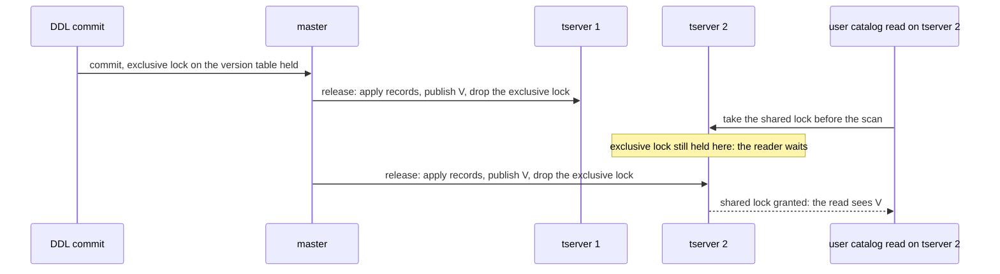

What exists already:

- Every DDL that increments a catalog version takes an exclusive object lock on the catalog version table before it writes the increment. That lock is a global object lock: it is fanned out to every tserver.
- Each tserver releases it only after its copy has applied the DDL and the versions are published (5.6). So on any tserver, once the exclusive lock is gone, that tserver's copy and shared memory already hold the DDL.

What is missing, and its cost:

- The reader side is one lock acquisition: a ROW SHARE object lock on the catalog version table before a user catalog scan. ROW SHARE is the weakest mode that conflicts with EXCLUSIVE; ACCESS SHARE does not conflict with it and would not do.
- ROW SHARE is a fast-path lock: it is taken in the tserver's shared memory with no RPC unless a DDL currently holds the exclusive lock on this tserver, in which case the reader waits for this tserver's release to finish. A DDL that starts later waits for the reader on every tserver.
- Cost: a DDL commit waits for in-flight user catalog scans. The lock lives until the transaction ends, so inside a transaction block it would hold every DDL in the cluster until that transaction ends. It is therefore taken only for statements that meet condition 1 of 6.2, where its lifetime is the statement. Statements in a block go to master, which is linearizable without a lock.
- Not verified: a transaction block that reads `pg_class` and then runs a DDL upgrades its own ROW SHARE to EXCLUSIVE; this is the same shape as DML followed by DDL on one table and is expected to work.
- The cost falls only on kind 3 reads. Kinds 1 and 2 (cache miss reads and internal catalog scans) keep the lock-free path.

## Appendix B: Releases without object locking (2026.1 and earlier)

The design above assumes object locking. Without it ("legacy mode" below), there is no object lock to release, so nothing fans a DDL out to every tserver, and DML and DDL are coordinated instead by two tserver-side checks with a retry: a tablet rejects a DML whose catalog version is below the last breaking version its tserver knows, and rejects a DML whose DocDB schema version is stale; the backend then refreshes its caches and retries once. Heartbeats deliver catalog versions on a best-effort basis. The copy fits that model as follows; the plan is detailed in `support_object_locking_off.md`.

### B.1 Goal and guarantee

Serve catalog reads from the copy in legacy mode, keeping the legacy guarantees and adding one:

|                                             | Legacy mode, no copy                                                              | Legacy mode with the copy                                                                                                                                                       |
| ------------------------------------------- | --------------------------------------------------------------------------------- | ------------------------------------------------------------------------------------------------------------------------------------------------------------------------------- |
| A completed DDL on other tservers           | the version arrives with a heartbeat                                              | the DDL's client is told success only after every lease holder's copy holds the DDL and has published the version (exception: the asynchronous fallback after the 60 s timeout) |
| Cached catalog entries of existing backends | refreshed when the version reaches the tserver, or after a version-mismatch error | the same                                                                                                                                                                        |
| Catalog cache misses                        | read master's latest state                                                        | read the copy at its safe time; after a completed DDL, every lease holder's copy includes it                                                                                    |
| A new connection's catalog version          | read from master                                                                  | read from the copy, with the catalog rows                                                                                                                                       |

### B.2 Prerequisites

- The YSQL lease on (it is a separate setting, on by default). The release targets, the lease bound and the PG start hold depend on it.
- Invalidation messages on.
- The places that today gate the feature on object locking (the copy's creation, the pusher, the tserver's local lock manager, the release handler) take the new condition: object locking on, or the lease and invalidation messages on. The catalog part of the release handler moves out of the lock manager, which does not exist in legacy mode. Master needs no gate change: its release fan-out depends only on lease refreshes.

### B.3 Version propagation: the release without locks

1. **DDL commit.** After a DDL transaction that incremented a catalog version commits, its tserver sends the same release RPC to master, with no locks in it, and waits for it as the synchronous release does under object locking; on timeout it falls back to asynchronous in the same way. In legacy mode the increment takes no object lock, so the trigger is the increment itself, in the DDL commit path.
2. **Master** fans the release out to every lease holder with the version map, the invalidation messages, the time it read the versions at and the pages, as under object locking.
3. **Tserver release handler.** It runs only the catalog part, in two steps: on arrival, update the breaking versions that the tablet-side version check reads; after the wait for the copy's safe time, publish the versions and messages to shared memory. The tablet-side check does not depend on the copy, so a stale DML is rejected as soon as the release arrives even if the copy lags; the rejected DML retries through B.5, which waits for the copy. When the copy does not serve, the handler publishes at once.
4. **Publish the copy's versions after every apply.** After the applier applies a page that carries a safe time, it reads the version rows and the new invalidation message rows from the copy at that time and publishes them, only forward, through the same call the release uses. Why: in legacy mode master holds no lock records for the DDL, so when the DDL's tserver dies before its release completes, nothing re-sends that release. The periodic pushes bring the DDL's rows into the copy anyway, and with this step the push that brings the rows also publishes the version: a tserver that missed a release is repaired within one push round trip, faster than the heartbeat repair before object locking. A version whose messages row is missing is published without messages, and backends do a full catalog refresh as they do today. (Under object locking this step is also safe, and not needed.)
5. **PG's own shared-memory write after a DDL** does nothing while the feature is on, as under object locking: the synchronous release has already published the same versions on the DDL's tserver.

Behavior changes for legacy users, all performance costs and none a blocker (each is a bounded wait on a state the copy reaches, never a wrong read):

- DDL latency depends on the slowest lease holder's copy. Legacy DDL never waited for other tservers; with item 1 every version-incrementing DDL waits until every lease holder's copy has reached the release's bound, up to the 60 s synchronous timeout, after which the DDL returns success and the release continues in the background. Option: wait synchronously only for the DDL's own tserver and release to the others asynchronously, at the cost that a catalog miss on another tserver right after the DDL returns may not see it for one push.
- After the asynchronous fallback, the DDL's own backend waits again: the existing wait for shared memory to reach its version polls for up to max(60 s, 10 heartbeats). Change: skip it when the release fell back, because the guarantee it serves has already been given up.
- Temp-relation DDL and `DISCARD ALL` that drops temp objects pay one push round trip on the session's next catalog read: in legacy mode no lock is taken and no version is incremented, so only the session floor covers the writer.
- PG start after a restart or lease regain waits for the copy, as under object locking.
- A release that a target refused is retried by master per target; in legacy mode item 4 is what repairs a release whose DDL tserver died.

The waits that today expect a heartbeat to raise the shared-memory version are satisfied by the release and by item 4: the backend's wait after its own global breaking DDL and under the connection manager, the retry refresh, a new connection revalidating the relcache init file, and index backfill waiting for the tserver's version (its heartbeat trigger becomes a floor request).

### B.4 Catalog read time in legacy mode

In legacy mode pggate keeps one catalog read time per backend: when it is empty, the next catalog read asks the tserver to pick a time; the tserver returns the time it picked and pggate sends it as an explicit read time on every later catalog read. The time is reset at the start of every frontend message, after a DDL commit, on a cache refresh from invalidation messages, and in the error path before the version read, so it lives for one message at most. This maps onto the copy's rules directly:

| Copy rule (object locking)                           | Legacy equivalent                                                                                                                                                               |
| ---------------------------------------------------- | ------------------------------------------------------------------------------------------------------------------------------------------------------------------------------- |
| A fresh CatalogSnapshot gets the copy's safe time    | the first legacy read after a reset arrives without a time; the tserver picks the copy's safe time and returns it                                                               |
| Later reads under the snapshot read at the same time | later reads carry that time explicitly; "at or below the copy's safe time: serve at it" always holds, because the safe time only grows                                          |
| The session floor before a fresh read                | the legacy fresh read goes through the same wait (open: the floor must be per backend for all session kinds)                                                                    |
| A snapshot that started on master stays on master    | when the copy does not serve, the first read gets a clock reading from master; later reads arrive with that time above the copy's safe time and wait for a push or go to master |
| DDL reads go to master                               | same                                                                                                                                                                            |
| SERIALIZABLE catalog reads go to master              | not needed in legacy mode: catalog reads in a serializable transaction carry no transaction, so the copy serves them                                                            |

The autonomous DDL transaction commits in DDL mode, which sets the commit part of the session floor; pggate then resets the catalog read time, so the next statement's fresh read waits for the floor. The user transaction that issued the DDL keeps its own data read point.

### B.5 The two retries that read master's version

Today, when a tablet rejects a DML for an old catalog version ("the catalog snapshot used for this transaction has been invalidated") or for a stale DocDB schema version ("schema version mismatch"), the backend reads master's current catalog version; if it differs from its own, it refreshes its caches (waiting up to max(60 s, 10 heartbeats) for shared memory to reach that version, then applying the messages, or doing a full refresh) and retries once.

The problem with the copy: that version read is an ordinary catalog read, so the copy answers it at its safe time. Master answers it at its latest time, so the read sees every DDL committed before it; the copy sees only DDLs up to its safe time. When the copy is behind the version that caused the rejection, the read returns the old version and no refresh runs. For a schema-version mismatch, the retry then has a fresh pggate table schema (fetched from master) and a stale `pg_attribute` in the relcache, which is the combination behind a known bug (a write short of columns, written into a packed row). Today that combination occurs only while the DDL's transaction has changed the DocDB schema version and not yet committed its catalog version increment; without the fix below, the copy would extend it to DDLs that have committed but whose rows the copy does not hold yet.

Fix: the version read on the retry path waits for the copy to catch up.

```
backend B on T2                              T1 (tablet's tserver)               master
DML with version v ──────────────────────►  map: breaking version vb > v
                                              reject
◄──────────── error (carries no hybrid time)
error path: version read marked "latest"
  T2: floor := T2's clock plus the skew bound (≥ commit of vb)
      floor request ─────────────────────────────────────►  cycles until the safe time ≥ floor
      wait until the copy's safe time reaches the floor; serve the read → version ≥ vb
      (the apply that moved the copy also published vb and its messages, B.3 item 4)
refresh: shared memory already holds vb; apply messages, retry
```

- Why the local clock alone is not enough: the error response carries no hybrid time from the rejecting tserver (only success responses propagate one), so T2's clock after the error is bounded relative to vb's commit only by the physical clock skew and may be below it. T2's clock plus the maximum skew is above every hybrid time in the cluster, so it is at or above the commit, which happened before the rejection. The lease bound uses the same reading.
- Cost: master does not move its clock for a floor, so the push reaches a floor ahead of master's clock only when master's clock passes it: up to about the skew bound (500 ms) per retry. This path runs only after a version-mismatch error; before the copy, the same path read master and could then wait for a heartbeat.
- Mechanism: one flag on the version read in the two error paths; the read arrives as a fresh legacy read because the catalog read time was reset just before; the tserver waits until the copy's safe time reaches the floor, then serves.
- The refresh still waits for shared memory to reach the version; item 4 of B.3 published it with the same apply, so no further wait.
- This restores today's behavior. It does not close the window in which the ALTER has changed the tablet's schema version and its catalog version increment is not committed yet; that window exists without the copy and needs a fix of its own.

### B.6 New connections

A new connection takes its catalog version from the copy, in the same read as its catalog rows, as under object locking. The relcache init file stays. When the new backend's version is above the init file's stored version, the revalidation waits for shared memory to reach the backend's version; because every apply publishes the copy's versions (B.3 item 4), shared memory trails the copy only between an apply and its publish, so the wait is short.

### B.7 Unchanged, out of scope, open

Unchanged: reads in DDL mode go to master; temp-relation DDL uses the session floor; restart and lease regain hold PG until the copy is current; PITR uses the restore message; major version upgrade needs no special case; parallel workers read the copy at their own safe time; the tablet-side breaking-version check uses the tserver's map, updated when a release arrives and after every apply, at least as fast as heartbeats updated it.

Out of scope: the response cache, sys-table prefetching and the startup preload; `yb_make_next_ddl_statement_nonincrementing`.

Open: whether the session floor is one per backend across the plain and the legacy catalog session kinds; where exactly the DDL commit path sends the release in legacy mode and who owns the resend loop without a lock manager; the gate changes of B.2; master-side release retries (a latency item, since item 4 repairs a refused release within one push); the choice between waiting for every lease holder or only the DDL's own tserver.

Tests: a DDL on one tserver and a catalog miss on another right after it returns (the miss sees the DDL, published by the release, not a heartbeat); `ALTER TABLE ADD COLUMN` on one tserver while another's copy is paused, then a DML on the altered table from that tserver (the retry's version read waits for the copy; no write with a stale `pg_attribute`); `REVOKE` with a paused copy (the breaking-version retry succeeds once the copy catches up); a release forced asynchronous (other backends get the version once the copy applies the DDL's pages, before the release arrives); a release that never reaches one tserver while pushes succeed (that tserver publishes the version from its copy after the next apply); `CREATE INDEX` with backfill (completes without heartbeat versions); an autonomous DDL followed by a statement in the same session (waits for the commit floor); a SERIALIZABLE transaction's catalog misses served by the copy; the copy's test suites run with object locking off.
