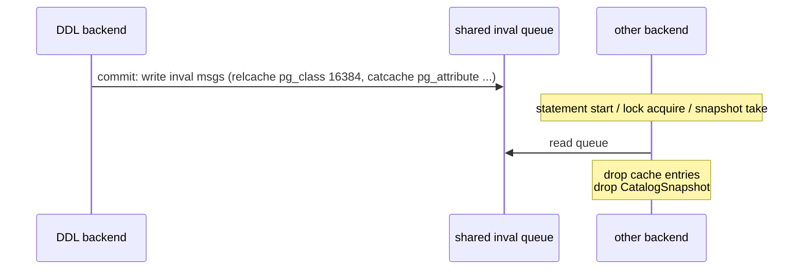
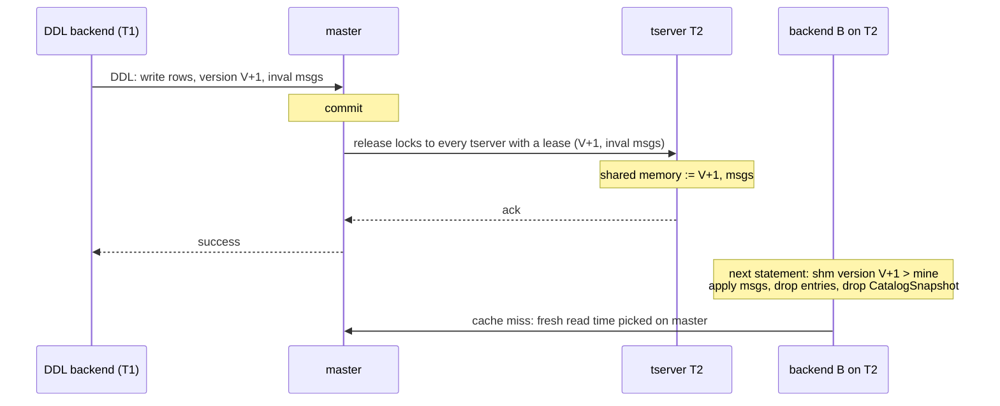
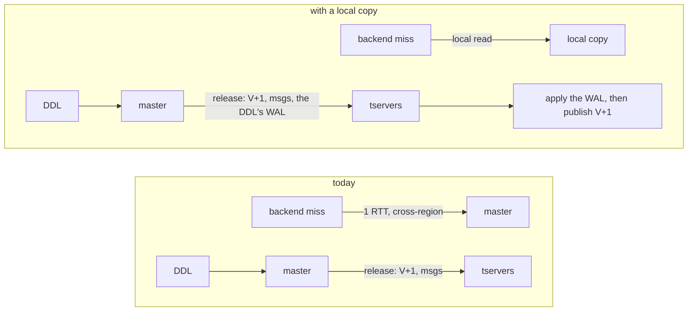
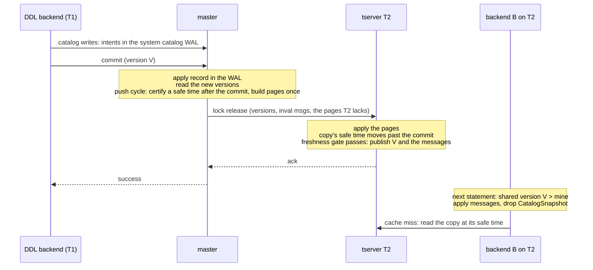
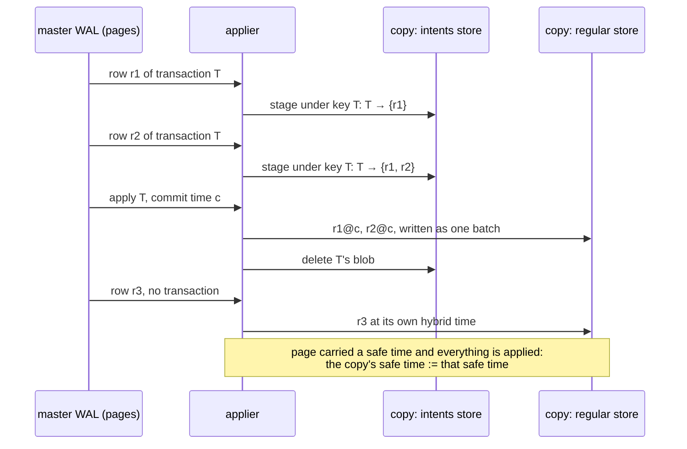
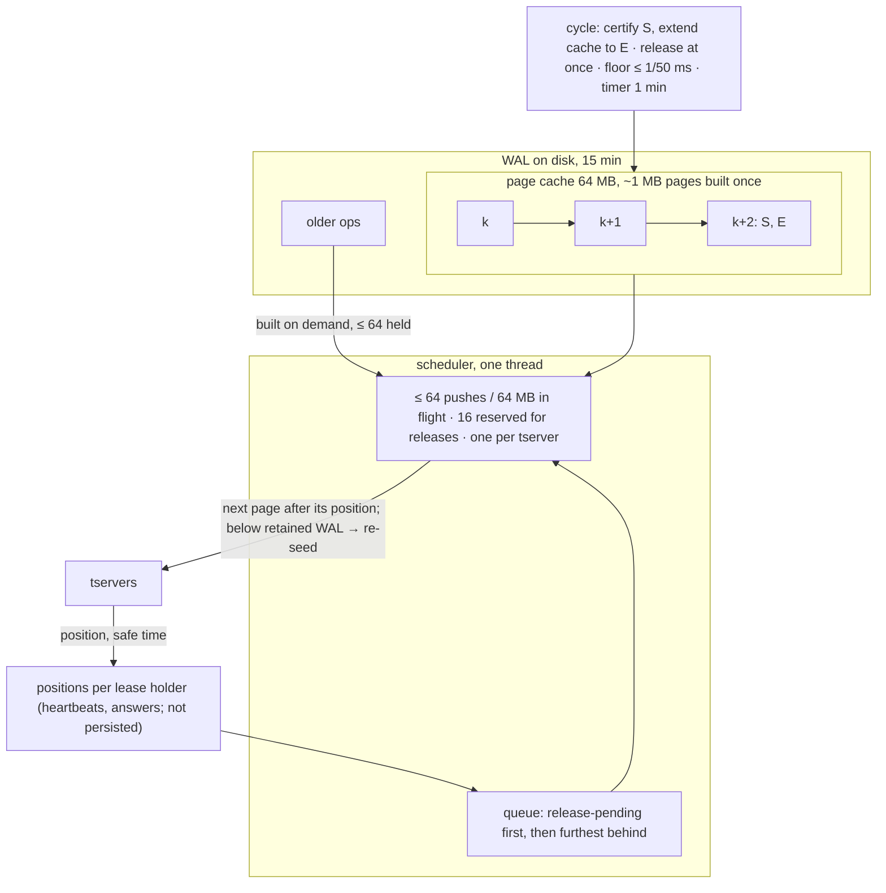
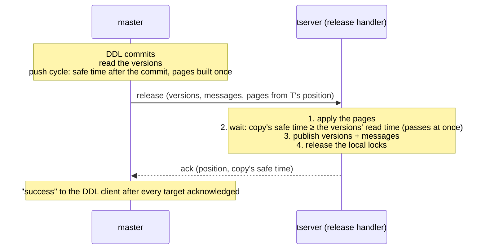
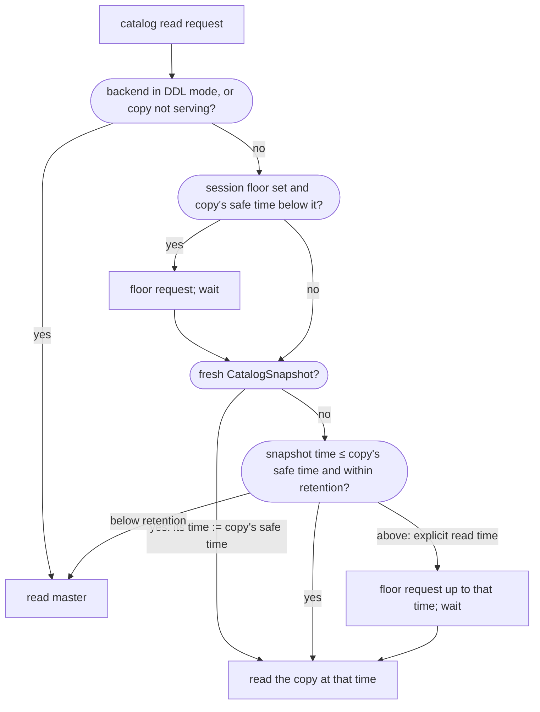
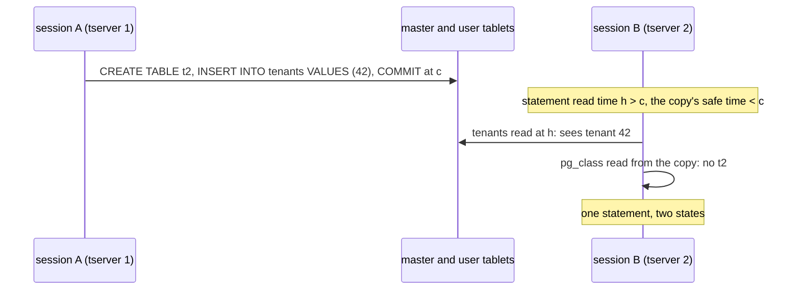
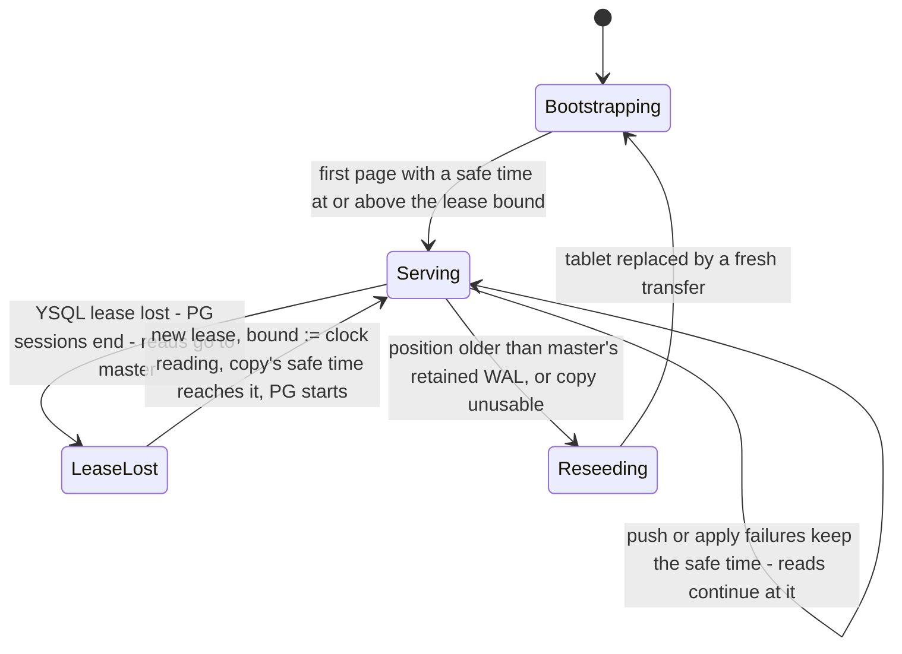

<!-- _class: lead -->
<style scoped>section{font-size:50px;}</style>

**Tserver-local copy of the PG catalog**

*v2, October 2026*

---
# Problem — a single query fans out into many serial catcache misses

```
SET yb_debug_log_catcache_events=1;
SELECT distinct key, count(*) FROM part_par GROUP BY key;

LOG:  catalog cache miss on cache id 54: pg_class      part_par
LOG:  catalog cache miss on cache id 54: pg_class      part_par (schema 2200)
LOG:  catalog cache miss on cache id 2:  pg_am         2
LOG:  catalog cache miss on cache id 45: pg_proc       2803
LOG:  catalog cache miss on cache id 0:  pg_aggregate  pg_catalog.count
LOG:  catalog cache miss on cache id 80: pg_type       23
```

Each miss is one master round trip. In a region 30 ms one way from master: **9.3 s** for this query on a fresh backend, **23 s** for a cold `\dt`; 1 ms and 0.3 s once warm.

---
## Problems

1. Latency on cold connections (especially multi-region).
2. Latency after DDL, when caches are invalidated and refilled from master.
3. Load on the master leader, proportional to the number of backends.
4. Queries on the catalog itself (`\dt`, `information_schema`) are extremely slow, and PG never caches them.

Connection pools help, but the first few queries on every new backend are still slow, and not everyone runs a good pool.

---
# Background: how PG reads its catalog

Three kinds of catalog reads, all under the backend's **CatalogSnapshot** (a per-backend snapshot used only for catalog access):

| Kind | What | Example |
|---|---|---|
| 1 | catcache / relcache miss | DML / planning |
| 2 | internal catalog scan | planner and DML paths scanning a catalog table directly |
| 3 | user catalog read | `\dt`, `\d`, `information_schema`, `SELECT ... FROM pg_class` |

Kind 1 is the common case: most misses fill the catcache once per backend and never repeat. What matters is the first few statements of every backend, and the first statement after a DDL.

Exceptions: the walsender (historical reads for logical decoding) and `ysql_dump --read-time`.

---
# Background: how PG invalidates its catalog caches



- A DDL writes invalidation messages to a shared queue at commit.
- Other backends read the queue at statement start, lock acquisition, snapshot take.
- Reading a message drops the named cache entries and the CatalogSnapshot; the next catalog read takes a fresh one.

---
# Background: YB today, object locking on



- Every DDL increments the catalog version under a **global exclusive lock** on the version table; the lock release goes to every tserver with a YSQL lease and carries the version and the messages. The client hears success after every tserver acknowledged.
- A backend reads its starting version from master, then watches shared memory.
- A fresh CatalogSnapshot picks its read time **on master**: every miss is a master round trip.

---
# Background: today's mitigations, and why they are not enough

| Problem | Mitigation today |
|---|---|
| Cold backend | preload catalogs into every backend (`ysql_catalog_preload_additional_tables`), relcache init file, tserver response cache, custom cache for pg_inherits, optimized relcache builds |
| Slow internal scans | convert each one into cache lookups, case by case (D55415) |
| Herd after a DDL | nothing |

- The preload list trades connection time and memory per backend for first-statement latency, and gets it wrong both ways.
- Response cache and init file are a second and third copy of the same rows, each with its own invalidation rule.
- The read path is a pile of special cases; kind 2 scans still have to be found one by one; kind 3 reads are never cached.

---
# The idea: a copy of the catalog on every tserver



- One **single-peer DocDB tablet** per tserver: a full copy of master's system catalog tablet, same table ids, schemas, row keys. Master stays the only writer and **pushes** its WAL to every copy.
- A fresh CatalogSnapshot takes its read time **from the copy** and sends every read there. Nothing else in the backend changes.
- Contract: a backend never reads a state older than one it was already told about; every read under one CatalogSnapshot sees one state.

---
# Why this is acceptable

- With object locking, backends already see different catalog states between a DDL's commit and the moment each backend applies the invalidation messages. Locks make that safe: a statement holds a lock on what it depends on, a DDL holds a conflicting lock until its release landed everywhere, and taking a lock processes pending messages.
- Statements that hold no lock on what they read (GRANT/REVOKE on the objects they affect, user catalog reads) can see the old state for the length of the fan-out. Accepted today.
- The copy does not widen the window: a tserver publishes the new version only after its copy holds the DDL's rows.
- Only difference: a backend not yet told the version reads the copy (pre-DDL state) where today it reads master. Today that is already inconsistent with the backend's own cached entries, which only the messages move forward. With the copy, misses and cached entries describe one state: PG's own model.
- New backends: today they start at master's latest version; with the copy, at the version the copy holds, read in the same snapshot as their rows. A DDL whose release has not landed is invisible to them exactly as it is to the existing backends, and its client has not heard success yet.

---
# Architecture



Four pieces: the **copy**, **master push** (pages, safe times, positions), the **freshness gate** in the release handler, the **read redirect** in the tserver.

---
# Terms

| Term | Meaning |
|---|---|
| **catalog version** | per-database counter incremented inside every DDL transaction (temp relations excepted); version order = commit order |
| **page** | the change records of a contiguous range of master's system catalog WAL, built once, sent unchanged to every tserver that lacks it |
| **safe time** | a hybrid time master certifies with a page: every catalog transaction that committed at or before it is applied on master and its records are in that page or an earlier one |
| **the copy's safe time** | the safe time of the last page the copy applied, every earlier page included: a value master certified, which the copy only records (not the DocDB safe time of the copy's own tablet). Complete for every writer up to it. Only moves forward |
| **lease holder** | a tserver with a live YSQL lease: the targets of every lock release and every push |

Rules:

- Every local read is at a time **at or below the copy's safe time**.
- A fresh CatalogSnapshot's read time := the copy's safe time; later reads under it reuse that time.
- A snapshot whose time is above the copy's safe time is never clamped down: the tserver asks master to push up to that time.
- **Freshness gate**: a tserver publishes a DDL's version only after the copy's safe time has passed the DDL's commit.

---
# The copy and its bootstrap

- A full copy of master's system catalog tablet; one peer (this tserver), replicates to nobody.
- Regular store + intents store, used the way an xCluster target uses them. No transaction ever runs locally.
- Invisible to master: not in the tablet map, never reported; splitting, load balancing, snapshots, admin compactions cannot address it. Reserved tablet id.
- Automatic compactions run, with history retention pinned to master's catalog window (4 h), so it answers the same historical read times master can.
- **Bootstrap**: remote bootstrap from the master leader's system catalog tablet in a private-copy mode. Serves only after the first pushed page with a safe time (and once the lease condition holds). A restart reopens from disk and resumes from the recorded position.
- **Re-seed**: the same transfer, when the copy's position is older than the WAL master retains (15 min) or the copy is unusable. Not serving meanwhile: reads go to master.

---
# Keeping the copy current 1/3 — master pushes pages with a certified safe time

```
cycle():
    S := the system catalog tablet's leader safe time
         (every write ≤ S is in the WAL; master's clock has passed S, so nothing can newly commit ≤ S)
    for every catalog transaction with intents whose outcome is unknown, ask its coordinator,
    which answers with the status and its own clock reading:
        committed ≤ S                    -> wait until its apply record is written here
        committed > S                    -> nothing to do
        aborted                          -> remove its intents
        pending, coordinator clock > S   -> nothing to do: if it commits, it commits above S
        pending, coordinator clock ≤ S   -> ask again (its clock passes S within a round trip)
    position := highest majority-replicated WAL position now
    build pages up to that position; the last page carries S
```

Invariant: a copy that applied every page up to the one carrying a safe time holds **every record of every transaction that committed at or before it**, apply records included. Row records of transactions that commit later may be there without their apply record; the copy stages them and never shows them. Same contract transactional xCluster relies on.

Pages are sealed at ~1 MB, at a restore, and at the certified position; built **once**; the same bytes go to every tserver below that range. A cycle that finds more than 1 MB of new WAL builds several pages; only the last carries the safe time.

---
# Keeping the copy current 2/3 — how records land in the copy



- A transaction's rows wait as **external intents** (one blob keyed by the transaction id, invisible to reads) and move to the regular store at the commit time, as one batch, when the apply record arrives. A DDL's rows and its version-row update appear together.
- Reads are never served above the copy's safe time, so no read ever depends on the intents store.

---
# Keeping the copy current 3/3 — the pusher



Release: 1. its own cycle → 2. per target, cached pages ≤ 4 MB ride inline in the release RPC, else the target is **pending** and the scheduler pushes it first → 3. at E, the release RPC follows with no pages.

- Positions are the tserver's: checkpointed on disk, reported in every heartbeat; a new leader learns them in one heartbeat interval.
- A target gets its next page when the previous push is answered (one page per push, in order). Cycles never wait for pushes.
- Below the retained WAL → "re-seed".

---
# The DDL path: the freshness gate



- Every version-incrementing DDL ends with a release to every lease holder (the global lock on the version table). Master runs **one** push cycle (safe time after the commit, pages built), then for each target: pages it lacks, if all cached and ≤ 4 MB (four pages), ride inside its release RPC; otherwise the pusher sends them first and the release (no pages) follows once master sees the target caught up; the handler never waits. The cap exists because releases go to every lease holder at once, outside the push bounds (`CREATE DATABASE` ≈ 12 MB).
- Step 2 is **the only thing the copy adds** to version propagation. A backend that takes a conflicting lock always sees the new version first.
- Master keeps a release until every lease holder acknowledged it or lost its lease; a copy that is behind answers so, and gets the release again once caught up. The client hears success after ≤ 60 s; then the release completes in the background.
- Heartbeat versions: **ignored while the copy serves**; applied at once while it does not (its catch-up path).

---
# Reads: the read time



- Served locally: all three kinds, outside DDL; startup reads, full cache refresh, parallel workers too. A new connection makes no master catalog round trip, and reads its version row in the same snapshot as its rows.
- **Session floor**: one time per session that its next fresh CatalogSnapshot must not fall below: set by a master answer (to the clock at the answer) or by a commit that wrote catalog rows (to the commit time). Routinely already satisfied by the DDL's own release.
- Versions and messages: **unchanged**. The backend watches shared memory and fetches messages from the tserver; the tserver fills them from the release, after the gate.

---
# Reads: what goes to master

| Case | Why |
|---|---|
| in a DDL statement, or a transaction block in which a DDL ran | its uncommitted catalog rows exist only on master and its own cache misses must see them: PG drops the CatalogSnapshot after the first catalog write, the recreated one gets its read time from master; sets the session floor |
| `yb_non_ddl_txn_for_sys_tables_allowed` (upgrade migrations, initdb) | same |
| SERIALIZABLE transaction | its reads carry no read time in YB (read locks, no snapshot) and today its catalog reads do the same: master answers each at its own time, as without the copy. Planned: served from the copy at one time like other isolation levels |
| read time below the copy's retention | would be snapshot-too-old; copy keeps master's 4 h |
| non-MVCC and historic snapshots | DDL-side or logical-decoding paths |
| copy bootstrapping, re-seeding, faulted, lease lost | copy not in the read path; a backend that read master in this state stays on master until it exits |

Not master, but a wait: an explicit read time above the copy's safe time (`yb_read_time`, `ysql_dump --read-time`, the walsender) → push up to that time, serve at it.

---
# What is no longer needed

| Today | With the copy |
|---|---|
| sys-table preloading on every connection | removed; init follows standard PG, each miss a local read (the relcache init file stays) |
| tserver response cache for preload and authentication | removed |
| mid-statement full cache refresh re-running the preload against master | removed; caches reset to empty and reload lazily |
| per-catalog custom caches; converting slow internal scans one by one | not needed: an internal scan is a local read |
| catalog versions by heartbeat to a healthy tserver | ignored while the copy serves; the release is the only path. Heartbeats still carry the applied position to master |

---
# User catalog reads — why they need their own rule

PG runs two snapshots per backend: the **catalog snapshot** (catcache/relcache loads) and the **transaction snapshot** (executor scans, including executor scans of `pg_class`). In PG `SELECT ... FROM pg_class` sees the transaction snapshot. YB today puts every catalog-table read on the catalog snapshot's time; with the copy that is the copy's safe time. Two things can go wrong:

- **Across tservers**: `\dt` on a tserver that published the DDL, then on one that has not. The release fan-out window; catcache reads have it today.
- **Inside one transaction or statement**: catalog read at the copy's safe time, user-table read at the transaction's later time.



---
# User catalog reads — proposal

Served from the copy by default when, decided once at executor start:

1. the statement is **not inside an explicit transaction block**, and
2. it references **only catalog tables** and calls **no user-defined function** (oid above the built-in range; extension functions count as user-defined).

| Admitted | Rejected (master, at the transaction's read time) |
|---|---|
| `\dt`, `\d`, `SELECT ... FROM pg_class`, `information_schema` views, schema-browser queries | anything inside `BEGIN ... COMMIT`; `SELECT ... FROM pg_class, user_table`; `SELECT f(relname) FROM pg_class` for a user function `f` |

- Rejected statements keep PG's semantics and today's cost; later served from the copy when the transaction's read time is at or below the copy's safe time (REPEATABLE READ's normal case).
- A setting serves every user catalog read from the copy (today's behaviour) for deployments that accept the skew.
- Implementable: PG hands the snapshot to every scan at start, so the kind is known; one flag per scan honoured by pggate; two tree walks with precedents, cached on the plan.

---
# Special cases 1/3 — remote bootstrap, and backends that read master

**Remote bootstrap**: the intents of catalog transactions open at bootstrap time arrive as ordinary intents; before the copy applies its first page they are converted into the external (staged) form the applier writes, so the transaction's apply record later finds all of its rows.

**Backends that read master, then return to the copy** — the session floor:

| Backend | Returns how |
|---|---|
| DDL statement / block | floor = clock at each master answer, commit time at commit; the DDL's own release normally already satisfied it; a rolled-back DDL block waits one push round trip |
| temp-relation DDL, `DISCARD` | commit floor; under object locking the temp relation's own lock release already moved the copy |
| SERIALIZABLE (today) | floor per master answer; planned: served from the copy |
| user catalog read in a block | floor; later served from the copy at the transaction's time |
| read while the copy was not serving | stays on master until the backend exits (could otherwise see a change, then lose it) |

---
# Special cases 2/3 — leases, releases, disabled writers



- **Lease loss / regain / restart**: a tserver without a lease is not a release target. On a new lease (incl. the first one of a new process) the tserver takes a clock reading above every DDL completed without it; each release arriving meanwhile publishes at once and raises that bound; PG's start is **held** until the copy's safe time reaches the bound (no timeout; a long outage ends in a re-seed). Backends are ended on loss as today.
- **A release that does not complete**: a copy behind the release's read time answers so; master pushes it first and sends the release again, same versions and bound, once it is caught up; the DDL's locks stay held there meanwhile. A dead DDL backend → its tserver sends the release; a dead DDL tserver → master releases its epoch's locks on expiry, with versions.
- **Disabled while the copy is on**: login profiles, large objects, direct catalog updates outside upgrade/initdb — they write catalog rows outside DDL and nothing moves the copy for them.

---
# Special cases 3/3 — PITR, major upgrade, and where a backend waits

- **PITR**: a restore is one Raft operation carrying the instruction; every master peer executes it on its own files (a filter hiding row versions above the restore time, a raised version row), so the row changes are not in the WAL. The copy does what a follower does: master sends a **restore message** to every lease holder, each copy applies the same filter to its own files (it keeps master's catalog history), writes the version row, publishes after its safe time passed the restore. RESTORED only after every lease holder acknowledged. Too-old history → re-seed.
- **Major version upgrade**: the copy keeps serving, no special case. Both catalogs are in the one tablet; initdb/pg_upgrade take no locks and bump no versions, their writes arrive by push; a backend switches catalogs only when its tserver restarts, and the restart hold makes PG wait for the copy. Cost lands on the rolling restart (the prototype's guard goes).
- **DDL announced through user data or NOTIFY**: rows and notifications are visible from the commit, the catalog change on each tserver once its release landed; a listener's `SELECT` on the new table can fail until then (today only for a backend with a negative cache entry). Fix for NOTIFY: the notifications poller holds a batch until the local copy's safe time passes the commit time.

| Who waits | For what | Routine cost |
|---|---|---|
| DDL client, and DML waiting for the DDL's lock | every lease holder's copy to apply its pages (the gate) | apply of a few KB; the slowest lease holder; ≤ 60 s |
| DDL's own session, next statement | copy past its commit | none; one push round trip after an async release |
| session after a rolled-back DDL block, SERIALIZABLE, user catalog read in a block | copy past its last master read | one push round trip |
| PG start after restart / new lease | copy's safe time ≥ clock at the lease | one push round trip + skew bound; or the missed WAL / a re-seed |

---
# Performance model

- **Reads**: a cache miss is a tserver-local read, 0.17–0.20 ms, against a cross-region round trip. Connection startup makes no master catalog round trip.
- **DDL**: one push cycle on master (a coordinator round trip only when another catalog transaction is open; pages built once) and the apply on each tserver before it publishes. 3 real tservers under 4 DDL sessions: p50 122 ms vs 99 ms, gate waits under 1 µs.
- **Master**: nothing when nothing changes. Per DDL: one cycle and one push RPC per tserver (~75 µs of master CPU each). Catch-up: ~1 ms of master CPU per MB sent, bounded in flight.
- **Post-DDL cost that is not the copy's**: a version increase drops the tserver's whole per-database table cache; the first statement then refetches each table from master (two round trips per table). Fix: the changed-table list in the release.

---
# Benchmarks 1 — setup

- Three yugabyted nodes, one per simulated region, real inter-node latency via tc: the master leader's region, a **remote AZ** 3 ms one way (6 ms RTT), a **remote region** 30 ms one way (60 ms RTT).
- Each region has its own copy of the schema in an RF1 tablespace pinned there — a backend touches only local data, so the number is the catalog path.
- **With copy**: prototype, release build, object locking + transactional DDL on. **2025.2.3 vanilla**: stock yugabyted at default flags, same cluster shape and delays.
- **Cold** = second cold run: a fresh backend runs the query once after an earlier backend on the node ran it, so the tserver's table cache already holds the query's tables and only the catalog path is measured. Median of 3 (copy), 1 sample (vanilla).
- **Post-DDL**: a backend that already ran the query; `ANALYZE` on one of its tables from the master's node; then the query again on the same backend.

---
# Benchmarks 1 — cold latency, ms

| Query | Remote region (60 ms RTT): copy | 2025.2.3 vanilla | Remote AZ (6 ms RTT): copy | 2025.2.3 vanilla |
|---|---|---|---|---|
| `SELECT DISTINCT key, count(*) FROM part_par GROUP BY key` | 51 | 9,273 | 48 | 1,029 |
| `SELECT count(*) FROM t01 WHERE c02 = 1 AND c03 = 1` | 25 | 4,095 | 24 | 455 |
| `SELECT * FROM mv_07 LIMIT 1` | 17 | 1,594 | 14 | 187 |
| `\dt` | 80 | 22,610 | 83 | 2,470 |
| `SELECT relname FROM pg_class WHERE oid = 't01'::regclass` | 41 | 9,450 | 53 | 1,023 |
| `\d+ t01` | 255 | 56,595 | 223 | 6,177 |
| `SELECT count(*) FROM information_schema.columns` | 140 | 32,787 | 137 | 3,658 |
| 10-way join on the primary key | 89 | 20,117 | 96 | 2,174 |
| new connection, `SELECT 1` (wall) | 28 | 268 | 32 | 53 |

- EXPLAIN: the partitioned-table query made 157 catalog read requests in 25 ms with the copy vs 152 requests in 9.2 s on vanilla (remote region).
- Same numbers in the remote AZ and the remote region: no catalog read leaves the node.
- Warm runs equal for cache-miss queries; user catalog reads stay slow on vanilla (`\dt` warm 307 ms vs 3 ms, `\d+` 3,552 vs 88, `information_schema.columns` 870 vs 29).

---
# Benchmarks 1 — post-DDL on a warm backend, ms

A backend that already ran the query; `ANALYZE` on one of its tables from the master's node; the query again on the same backend.

| Query | Remote region: copy | vanilla | Remote AZ: copy | vanilla | table-metadata requests to master, remote region (schema + locations): copy / vanilla | cold, copy, remote region |
|---|---|---|---|---|---|---|
| `SELECT DISTINCT key, count(*) FROM part_par GROUP BY key` | 501 | 911 | 59 | 101 | 4 + 4 / 5 + 5 | 51 |
| `SELECT count(*) FROM t01 WHERE c02 = 1 AND c03 = 1` | 367 | 1,034 | 42 | 114 | 3 + 3 / 3 + 3 | 25 |
| `SELECT * FROM mv_07 LIMIT 1` | 245 | 427 | 28 | 47 | 2 + 2 / 2 + 2 | 17 |
| `\dt` | 370 | 670 | 44 | 74 | 3 + 3 / 3 + 3 | 80 |

- The warm backend keeps its catalog caches (per-relation invalidation only). The cost is the tserver's **table cache** (DocDB schema + tablet locations of every table a request names, catalog tables included), dropped for the whole database when a new catalog version is published: two serial round trips per table, time ≈ requests × RTT, the same for a DDL on a table the query does not read.
- A backend that had not opened the tables (a new connection) pays that refill for every table of its statement: 3–4 s in the remote region, with or without the copy, vs 25–80 ms cold.
- Fix: incremental tserver cache invalidation — the release carries the DDL's changed-table list, the tserver evicts only those. Post-DDL = cold.

---
# Benchmarks 2 — master under load: why push

Release build, one master on 16 vCPUs, one real tserver, N push receivers in a test process standing in for N tservers (no lease, so no DDL waits for them).

v1 pulled: every tserver polled its own window of the WAL and master rebuilt and serialized the same response once per tserver — 97% of its CPU under load, **25 ms of master CPU per MB** sent to one tserver.

| Pull, measured | |
|---|---|
| N=100 tservers each catching up 50 DDLs | master saturated: **15.2 of 16 cores** |
| N=1000 under continuous DDL | 6.8 cores |
| idle cluster, N=8000 | 5.5 cores of empty polls |

With push, pages are built once, the same bytes go to every target, and at most 64 RPCs / 64 MB are in flight.

---
# Benchmarks 2 — steady DDL fan-out and catch-up (push)

Steady: 4 DDL sessions (CREATE TABLE, ADD COLUMN, DROP TABLE loop), 30 s.

| | N=1 (baseline) | N=200 | N=1000 |
|---|---|---|---|
| master cores (above baseline) | 1.5 | 2.4 (0.9) | 4.4 (2.9) |
| DDLs in 30 s | 1,149 | 1,119 | 1,000 |
| bytes sent | 16 MB | 3.0 GB | 13 GB (430 MB/s) |
| added master CPU per push RPC | — | 66 µs | 79 µs |
| DDL p50 / p99 | 99 / 158 ms | 102 / 165 ms | 118 / 198 ms |

Catch-up: K receivers start behind, no DDL during the phase.

| | K=100, 50 DDLs | K=1000, 50 DDLs | K=100, 2000 DDLs | K=1000, 2000 DDLs |
|---|---|---|---|---|
| bytes sent | 87 MB | 0.87 GB | 2.6 GB | 25.8 GB |
| master CPU | 0.45 CPU-s | 1.3 CPU-s | 3.2 CPU-s | 21.5 CPU-s |
| master CPU per MB | 5.2 ms | 1.5 ms | 1.25 ms | 0.83 ms |
| all caught up, p50 / max | 609 / 633 ms | 0.88 / 1.21 s | 1.9 / 2.0 s | 14.0 / 14.2 s (loopback) |

Profile at K=1000: the one pusher thread is at 100% of a core (63% of master's samples) → catch-up runs at ~1.8 GB/s. Two thirds of it is per-target work on identical bytes: two copies per page (34%) + CRC32c (8%). Fix: serialize + checksum each page once, send as a shared buffer (sidecar); coalesce the ~6 KB per-DDL pages for catch-up.

---
# Benchmarks 2 — large DDL, idle, real tservers

| Scenario | Result |
|---|---|
| `CREATE DATABASE` to N receivers (11.85 MB each) | N=100: 1.2 GB, all at the head 0.49 s after the statement, master 2 CPU-s incl. the statement. N=1,000: 11.85 GB, all at the head 4.7 s after (loopback ~2.5 GB/s; ~9 s at 10 Gbit), master 10 CPU-s. |
| idle, N=8000, 30 s | 0 push cycles; 0.16 cores incl. one initial 247 KB push per new receiver |
| 3 real tservers with copies, 4 DDL sessions | master 1.97 cores (baseline 1.65); 1004 DDLs in 30 s, p50 122 ms, p99 193 ms; gate waits mean < 1 µs |

What it means:
- Steady fan-out ≈ 75 µs of master CPU per push RPC, ~1 RPC per DDL per target: **1000 targets at ~33 DDLs/s ≈ 2.9 cores**. Batching DDLs per push cuts it in proportion.
- Catch-up ≈ 0.8–1.3 ms per MB, one pusher thread at ~1.8 GB/s; the in-flight bound holds master's memory flat.
- An idle cluster costs nothing after the first push to each target.
- Master's NIC sets the time for large DDLs (11.85 GB for `CREATE DATABASE` × 1000 ≈ 9 s at 10 Gbit); a one-level tree through tservers would cut it when needed.

---
# Without object locking (2026.1 and earlier): the backport

No lock to release, so nothing fans a DDL out; DML/DDL coordination is the tablet-side version and schema checks plus one retry; heartbeats deliver versions best-effort. The copy fits as follows (Appendix B of the design doc):

1. **DDL commit** still sends the release RPC, with no locks; master fans it out to every lease holder with versions, messages, read time and pages; the tserver handler runs only the catalog part: update the breaking versions on arrival, publish after the copy's safe time reached the read time.
2. **Publish the copy's versions after every apply**: master has no lock records to retry from when the DDL's tserver dies, so the push that brings the rows also publishes the version (read from the copy at its safe time, only forward).
3. **The two retries** (breaking-version rejection, schema-version mismatch) read master's version today; with the copy that read waits until the copy's safe time reaches the tserver's clock plus the skew bound, so the refresh sees the DDL and the known stale-`pg_attribute` bug stays closed.
4. Legacy read time (one per backend, reset per message) maps onto the copy's rules one to one; SERIALIZABLE needs no exception in legacy mode.

Behavior changes, all performance, none a blocker: DDL latency bound to the slowest lease holder's copy (≤ 60 s, then async); temp-relation DDL pays one push round trip; PG start waits for the copy.

---
# Status and follow-ups

Prototype: https://github.com/iSignal/yugabyte-db/tree/local_catalog_tablet_v2 — C++ suite (bootstrap, restart, re-seed, routing and the time rule, freshness across tservers, lease rejoin, push and catch-up, load harness); a full CI run with the feature on by default left fewer than 50 failing tests, mostly tests that count master round trips (not re-run on the latest code).

Before shipping:
- Remote bootstrap: open transactions' intents converted to the staged form; start from master's committed log position.
- Master-driven release completion (pending set, no handler wait); release bound = newest commit among the versions it carries.
- Restore message for PITR; serving withdrawal on local faults; SERIALIZABLE from the copy.
- Login profiles, large objects, direct catalog writes: disabled, then supported.
- User catalog reads guard.

Follow-ups:
- Changed-table list in the release (post-DDL table cache).
- Preload and response cache removal; invalidation messages read from the copy.
- Batching DDLs per push; one-level tree for large DDL fan-out.
- DDL completion measured with 1000 real tservers; observability pages.
